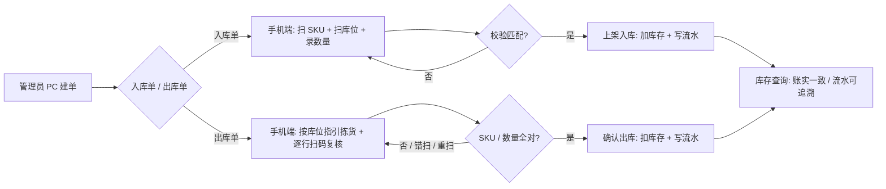

# GenisourceWMS MVP PRD

状态：已确认（2026-11-07；范围扩展已确认 2026-11-10）

## 核心需求
为**自营电商 / 贸易仓**（多 SKU、订单驱动出入库）提供一套 Web 化仓库台账：**PC 后台管资料与单据，手机扫码完成仓内作业**，替代 Excel / 纸单，解决「库存不准、拣货错发漏发、变动无法追溯」的问题。

## 验证目标
一批货从**采购入库 → 扫码上架 → 库存查询 → 出库单 → 扫码复核 → 出库扣减**全链路在系统内跑通；复核后库存数量与实物一致，且每笔增减可查到「谁 / 何时 / 哪张单 / 变动量」。跑通即证明「系统能替代 Excel 台账」，可以进入下一阶段。

## 核心功能（MVP 范围）
1. **基础资料**：SKU（编码即条码、名称、规格）、库位（层级编码如 A-01-02）、往来单位（供应商/客户）的增删改查与列表。
2. **入库**：后台创建入库单（关联供应商、多行 SKU×数量）→ 作业员手机端收货，逐行扫/输 SKU 与库位并确认数量 → 上架即入库，实时加库存。
3. **库存**：按 SKU / 库位实时查询在库数量（无冻结、无在途）；每笔增减生成一条库存流水台账，可筛选查看。
4. **出库**：后台创建出库单（关联客户、多行 SKU×数量）→ 作业员手机端按拣货指引到库位取货，逐行扫码复核 SKU 与数量 → 全部行通过后确认出库，实时扣库存。
5. **用户与操作日志**：内置管理员账号，账密登录；管理员（PC 后台：资料/单据/查询）、作业员（手机端：收货上架/拣货复核）2 个角色；所有库存变动写操作日志。

## 明确不做
- 业务功能：退货/换标、统计报表看板、多仓、多货主 3PL、计费结算、预留/冻结库存、在途库存。**盘点单、库位间调拨、批次/效期/FIFO 已于 2026-11-10 移出本清单，见「扩展范围」**。
- 集成：ERP / 电商平台对接、订单 API 推送、CSV/Excel 批量导入或导出、标签打印与打印设备对接、一物一码序列号。
- 账号：注册、找回密码、SSO、角色/权限可视化配置、细粒度权限。
- 工程默认预填：404 页、布局工具组件（grid 等）——MVP 路由与布局规模很小，不需要；有真实路由规模时再移出。
- 视觉：高保真设计稿、主题切换、暗色模式（视觉规范留到交互原型阶段确认）。

## 扩展范围（v0.2，2026-11-10 确认）

用户确认从「明确不做」移出三项，作为第二阶段范围。三项**复用现有单据与事务骨架**，且全部写入库存流水与操作日志，「账实一致 + 可追溯」的验收信号不变。

1. **盘点单**：按库位生成盘点单，录入实盘数量；盘盈/盘亏生成差异调整流水（`type=ADJUST`），单据完成后更新库存。不锁库、不做循环盘点。
2. **库位间调拨**：从源库位扫码下架 → 目标库位扫码上架；同一事务内一减一增两条流水，净库存不变但库位分布变化。不允许跨 SKU、不允许负库存。
3. **批次 / 效期 + FIFO**：SKU 增加批次号与效期字段；入库时登记批次；出库拣货指引按**效期升序（FIFO/FEFO）**分配库位与批次；库存与流水按 `(sku, location, batch)` 粒度记账。

**对架构的影响**（实现时遵循 [SYSTEM_DESIGN.md](SYSTEM_DESIGN.md) 的硬约束）：
- Flyway `V3__extended_features.sql` 新增表（盘点单/行、调拨单/行、批次、批次库存），并给 `inventory_txn` 增加 `batch_id`、`type` 扩展枚举。
- 拣货指引改为按批次效期排序；库存真值从 `(sku, location)` 细化到 `(sku, location, batch)`。
- 三项调整仍**只走 `InventoryService.recordStockChange` 单入口**，Controller 不得直接改库存；流水与审计只追加。

**仍不做**：CSV 导入导出、报表看板、ERP 对接、退货换标、多仓/3PL/计费、冻结库存。

## 核心功能流程图


## UI 线框图
### 屏幕 1：PC 后台 · 登录
```
+---------------------------------------------------+
|              GenisourceWMS                        |
|   +-------------------------------------------+   |
|   |  用户名  [____________________]           |   |
|   |  密码    [____________________]           |   |
|   |              [ 登 录 ]                    |   |
|   +-------------------------------------------+   |
+---------------------------------------------------+
```
交互：账密校验成功进入后台；失败在表单内提示。

### 屏幕 2：PC 后台 · 主框架（各页共用）
```
+-------------------------------------------------------------+
|  GenisourceWMS        [管理员 ▾]  [退出]                      |
+----------+--------------------------------------------------+
| 基础资料 |  页面标题                        [+ 新建]          |
| · SKU    |  ┌────────────────────────────────────────────┐  |
| · 库位   |  │ 列表 / 表单区（按当前页切换）               │  |
| · 往来单位|  │                                            │  |
| 入库单   |  │                                            │  |
| 出库单   |  │                                            │  |
| 库存查询 |  └────────────────────────────────────────────┘  |
| 库存流水 |                                                   |
| 操作日志 |                                                   |
+----------+--------------------------------------------------+
```
交互：左侧导航切换页面；「+ 新建」打开当前页表单（SKU / 库位 / 单位 / 入库单 / 出库单）。

### 屏幕 3：PC 后台 · 单据详情（入库单 / 出库单）
```
+-------------------------------------------------------------+
|  ← 返回列表    入库单 RK-20261106-001   [草稿]  [手机端作业]  |
+-------------------------------------------------------------+
|  供应商：XXX贸易公司      创建人：admin    创建时间：...        |
+-------------------------------------------------------------+
|  行 | SKU        | 名称     | 应收/应发 | 已收/已发 | 库位      |
|  1  | SKU-1001   | 商品A    |    20     |    20     | A-01-02   |
|  2  | SKU-1002   | 商品B    |     5     |     0     | 待上架     |
+-------------------------------------------------------------+
|  状态：部分完成 → 全部行完成后自动置为「已完成」               |
+-------------------------------------------------------------+
```
交互：管理员建单时逐行添加 SKU 与数量；「手机端作业」生成带单号的作业入口（二维码/链接）；行状态随手机端扫码进度实时更新。

### 屏幕 4：PC 后台 · 库存查询 / 库存流水
```
+-------------------------------------------------------------+
|  库存查询                    [SKU 搜索] [库位筛选] [查询]      |
+-------------------------------------------------------------+
|  SKU        | 名称    | 库位      | 在库数量 | 最近变动       |
|  SKU-1001   | 商品A   | A-01-02   |    20    | 11-06 22:10   |
+-------------------------------------------------------------+
|  切换「库存流水」：时间 / 单号 / SKU / 库位 / 变动量 / 操作人  |
+-------------------------------------------------------------+
```
交互：查询条件筛选；点击 SKU 可展开该 SKU 的流水明细，核对账实。

### 屏幕 5：手机端 · 作业单列表
```
+---------------------------+
|  作业任务        [退出]   |
+---------------------------+
| 待处理                    |
| ┌───────────────────────┐ |
| │ 入库单 RK-...-001     │ |
| │ 供应商 XXX  ·  2 行   │ |
| │            [开始作业] │ |
| └───────────────────────┘ |
| ┌───────────────────────┐ |
| │ 出库单 CK-...-001     │ |
| │ 客户 YYY  ·  3 行     │ |
| │            [开始作业] │ |
| └───────────────────────┘ |
+---------------------------+
```
交互：作业员登录后只看到待处理单据；点「开始作业」进入逐行扫码页。

### 屏幕 6：手机端 · 扫码作业（入库上架 / 出库复核）
```
+---------------------------+
|  ← RK-...-001   行 2/2   |
+---------------------------+
|  目标：SKU-1002 商品B     |
|  应上架：5 件             |
+---------------------------+
|  [ 📷 扫描 / 输入编码 ]   |
|  SKU  __________________  |
|  库位 __________________  |
|  数量 [  5  ]             |
+---------------------------+
|  ✓ 已扫 1/2 行           |
|       [ 确认本行 ]        |
+---------------------------+
```
交互：扫/输 SKU 与库位（出库时按指引库位），系统严格校验：SKU 不匹配、库位不符、重复扫同一行、数量超单均拦截并在页面内报错；本行确认后进度 +1；全部行完成 → 单据自动完成、库存增减、写流水；返回列表。

## UI 规范
**已定稿**：直接沿用 `~/Workspace/AI-APP/GenisourceMES` 的设计系统，不另立视觉风格。完整规范见 [design-system.md](design-system.md)，设计落地映射见 [SYSTEM_DESIGN.md](SYSTEM_DESIGN.md) §8。要点：

| 项 | 规范 |
| --- | --- |
| 色 | 深蓝 `#064584`（主操作/链接/单号）+ 青绿 `#21997A`（当前状态/进度/聚焦，单屏 ≤5%）+ 白；1px 发丝线 `rgba(6,69,132,.10)`，**不用阴影**；深底 `#001E42` |
| 字体 | Poppins（标题）/ Inter（界面）/ IBM Plex Mono（编码、单号、数量、时间）；只用 400/500/600；最小 11px；中文行高 1.75 |
| 布局 | 248px 深蓝侧轨 + 60px 白顶栏；页面最大 1440px、24px 边距；圆角 4/6/8/12/16；数据表单行 44px、无斑马纹 |
| 手机端 | 复用 MES「工位终端」范式：全屏深蓝 `#001E42`、提亮扫描框 + 青绿 2px 聚焦环、2×2 按键 ≥84px 高、扫描框 18px 字号 |
| 错误反馈 | 就近显示在表单/扫码区内（`--gs-danger` 文字 + 图标），不用全局弹窗打断作业 |
| 硬约束 | 只引用 `--gs-*` token，不在组件里写死颜色；不引入第二套 UI 框架 |

## 技术栈
**全栈对齐 GenisourceMES**（用户确认，含后端），与 MES 同构，便于后续「工单领料 ↔ 出库单」联动与统一运维：

- 前端：React 19.3 + TypeScript 5.9 + Vite 8 + pnpm 10 + TanStack Query 5 + react-router-dom 7 + i18next（仅 `zh-CN` 完整文案）+ dayjs；自绘 `--gs-*` 设计系统（PC 后台与手机端为同一 SPA 内两套布局/路由）
- 后端：Java 21 + Spring Boot 4.1.2 + Spring Data JPA + Spring Security（JWT HS256，Access 15m / Refresh 7d）+ Flyway + springdoc-openapi
- 数据库：PostgreSQL 17
- 部署：Docker Compose（web / app / db 三容器 + Nginx 反代）
- 视觉：见上方 UI 规范（已定稿，不再等原型）

## 关键决策清单（grill 收敛）
1. 用户：自营电商 / 贸易仓，验证「替代 Excel 台账」；验收信号 = 全链路跑通 + 账实一致 + 变动可追溯。
2. 形态：PC 后台 + 手机浏览器扫码作业，纯 Web 无原生 App。
3. 范围：MVP 只做「基础资料 / 入库+扫码上架 / 库存+流水 / 出库+扫码复核 / 用户角色+日志」5 项。**2026-11-10 起增加扩展范围（见专章）：盘点、调拨、批次效期 + FIFO**；报表、多仓、ERP 对接、CSV 导入导出仍砍掉。
4. 数据：SKU 编码即条码、库位层级编码；后台手工建单，上架即入库、复核即出库；账密登录 + 2 角色，全量操作日志。（注：扩展范围会把库存粒度细化为 `(sku, location, batch)`，但「单层在库数量、无冻结/在途」的语义不变）
5. 待定（不在本阶段决策）：技术细节取舍（工程搭建阶段，如扫码库最终选型、真机兼容）。
6. 技术栈与 UI 视觉规范：**全栈对齐 GenisourceMES**（Java 21 + Spring Boot 4.1 + JPA + Flyway + PostgreSQL 17 + Spring Security JWT；React 19 + Vite 8 + TS 5.9 + pnpm + TanStack Query 5 + react-router 7 + i18next；`--gs-*` 设计系统；Docker Compose 部署）。UI 规范随此定稿，不再等交互原型阶段。（2026-11-07 确认）
7. 扩展范围（2026-11-10 确认）：移出「明确不做」的三项为 ① 盘点单（盘盈盘亏调整流水）② 库位间调拨（一减一增同事务）③ 批次/效期 + FIFO/FEFO 拣货。CSV 导入导出、报表看板、ERP 对接**仍不做**。同时补齐 B 类欠账（摄像头扫码、语言切换、自动化测试、Docker 全栈实跑）与 C 类打磨（单据编辑/作废、用户管理、分页筛选、总览待办、库存预警）。
