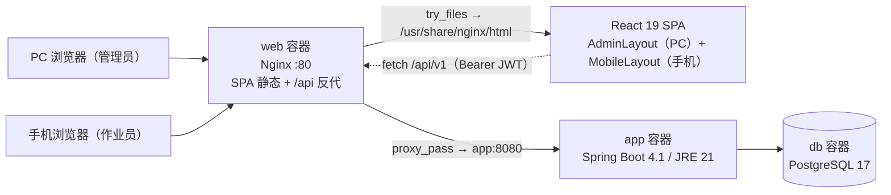
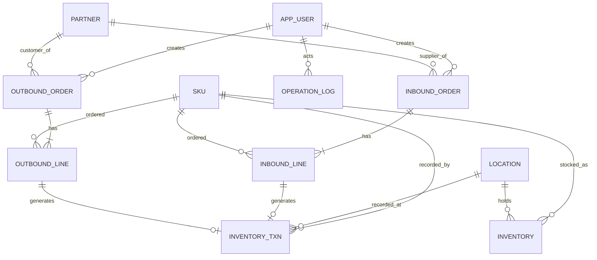
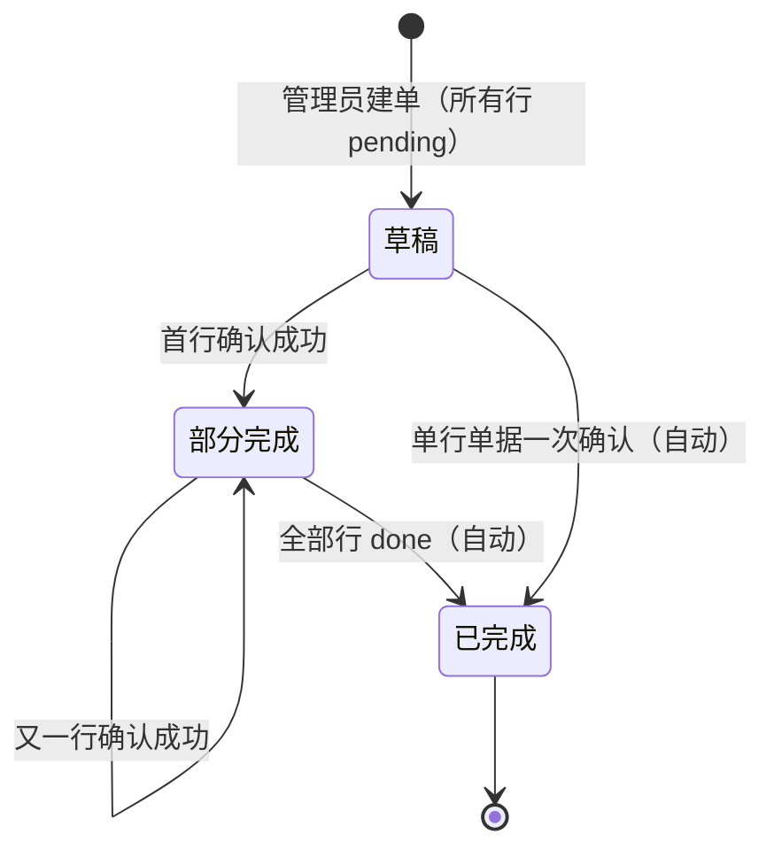
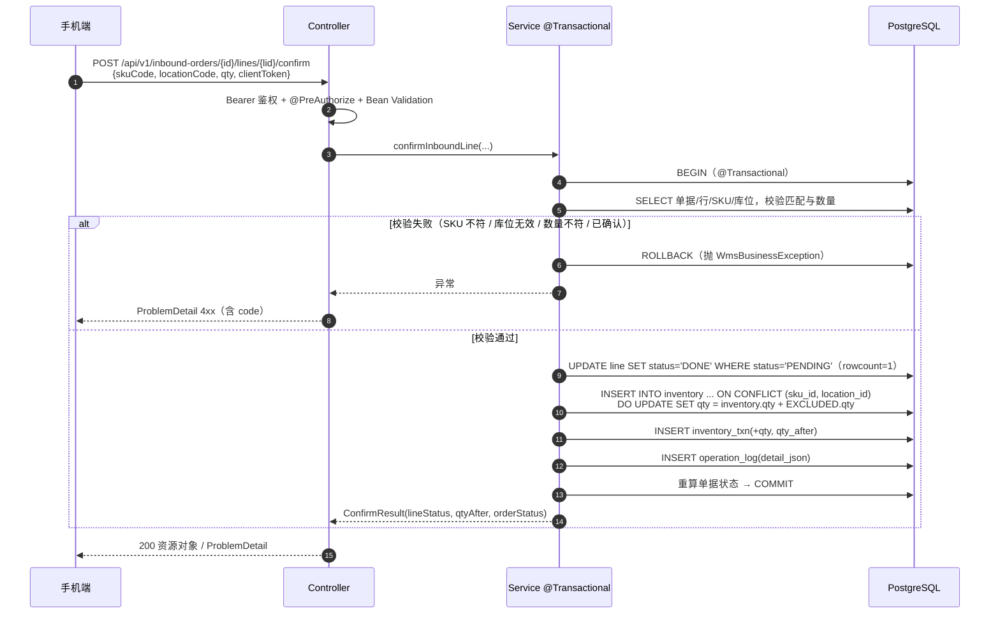
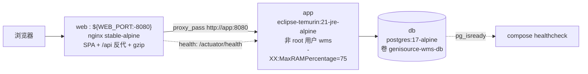

# GenisourceWMS 系统设计文档（SDD）

| 项目 | 内容 |
| --- | --- |
| 版本 | v0.2 |
| 日期 | 2026-11-06 |
| 状态 | 依据 `docs/PRD.md`（**已确认 2026-11-07**）编写；v0.2 起**技术栈与 UI 视觉规范全面对齐 `~/Workspace/AI-APP/GenisourceMES`** |
| 适用范围 | MVP（验证「替代 Excel/纸单台账」），不含生产级多仓、3PL、计费 |
| 对齐基线 | MES `README.md` / `pom.xml` / `frontend/package.json` / `compose.yaml` / `docs/design-system.md` / `frontend/src/styles/global.css` / `deploy/nginx/default.conf` |

> 阅读顺序建议：§2 架构 → §4 数据模型 → §5 状态机 → §6 API → §8 UI 视觉规范 → §11 验收方案。
> 本文档只做**设计决策与契约**，不产出代码；代码在工程搭建（mvp-scaffold）与纵切开发阶段落地。

---

## 0. v0.2 对齐决策（重要）

用户确认「技术栈与 UI 视觉规范参考 GenisourceMES」，且明确选择**后端也换成 Java 全家桶**（不只是前端）。据此，v0.1 的默认栈（FastAPI + SQLite + Alembic + 单 VPS/systemd）**整体退役**，替换为与 MES 同构的栈。

| 维度 | v0.1（已退役） | **v0.2（当前，对齐 MES）** |
| --- | --- | --- |
| 后端 | Python 3.11 + FastAPI + SQLAlchemy + Alembic | **Java 21 + Spring Boot 4.1.2 + Spring Data JPA + Spring Security + Flyway** |
| 数据库 | SQLite 单文件 + WAL | **PostgreSQL 17（Docker Compose）** |
| 认证 | JWT HttpOnly Cookie + 2 硬编码角色 | **JWT HS256（Access 15m / Refresh 7d，Bearer 头 + localStorage）+ 数据库 RBAC** |
| 前端 | React 18 + Vite + TS（版本未锁） | **React 19.3 + TS 5.9 + Vite 8 + pnpm 10.32.1 + TanStack Query 5 + react-router-dom 7 + i18next + dayjs** |
| 样式 | 「待交互原型确认」 | **自绘 `--gs-*` 设计系统（深蓝 #064584 / 青绿 #21997A / 白）**，见 §8 |
| 错误格式 | `{code, message, data}` 自定义包 | **RFC 9457 `ProblemDetail` + `MessageSource` 双语**，见 §6 |
| 部署 | 单 VPS + Nginx + Uvicorn + systemd | **Docker Compose（web / app / db 三容器）+ Nginx 反代** |

**为什么要同构**：MES 与 WMS 后续必然要做「工单领料 ↔ 出库单」「完工入库 ↔ 入库单」的联动；同栈意味着 Flyway 迁移风格、JWT/RBAC 鉴权链、`http.ts` 请求层、`global.css` 原子类、Docker 部署脚本可以互相复用，运维只需维护一套镜像/备份/监控体系。代价是 MVP 起步比 FastAPI 重，已接受。

**对齐清单（哪些抄、哪些不抄）**

| MES 能力 | WMS 是否纳入 | 说明 |
| --- | --- | --- |
| Spring Boot 模块化单体 + Flyway + JPA `ddl-auto: validate` | ✅ 纳入 | 后端骨架完全同构 |
| `ProblemDetail` + `MessageSource` + `Accept-Language` | ✅ 纳入 | 统一错误契约 |
| JWT Access/Refresh + 每请求查库重建权限 | ✅ 纳入 | 撤权即时生效 |
| 数据库 RBAC 表结构（user / role / permission） | ⚠️ 结构纳入、能力收敛 | 只 seed `ADMIN` / `OPERATOR` 两角色；**不做权限可视化配置**（PRD 明确不做） |
| `--gs-*` 设计系统、`BrandMark` / `Icon`、工位终端视觉 | ✅ 纳入 | 手机端扫码作业直接复用 MES「工位终端」范式，见 §8.7 |
| i18next 双语脚手架 | ⚠️ 脚手架纳入、文案收敛 | MVP 只交付 `zh-CN` 完整文案，`en-US` 保留占位与 key；不扩大范围 |
| 工位设备码 / 强制首次改密 / 临时密码 / demo profile 演示数据 | ❌ 不纳入 | 超出 PRD 的 5 项功能范围 |
| 独立 404 页 / 布局工具组件 | ❌ 不纳入 | PRD「明确不做」优先，见 §8.9 偏差说明 |

---

## 1. 设计目标与约束

### 1.1 设计目标
1. **账实一致**：库存增减必须与实物的扫码确认一一对应，任何时刻可从流水重算出当前库存。
2. **作业防错**：错 SKU、错库位、重复扫、超量，一律在确认写库前拦截。
3. **全链路可追溯**：谁 / 何时 / 哪张单 / 哪一行 / 变动多少，可查询。
4. **与 MES 同构可复用**：一条 `docker compose up` 起全栈；目录、鉴权链、错误契约、设计 token、部署脚本与 MES 可互相拷贝。

### 1.2 约束与非目标
- 范围严格对齐 PRD 的 5 项核心功能；盘点、调拨、批次/效期/FIFO、冻结库存、多仓、多货主、ERP 对接、导入导出、标签打印、注册/找回/SSO、权限可视化配置均不设计。
- 库存只有「在库数量」一层；不设预留、在途、冻结。
- **UI 视觉规范不再留到原型阶段**：已按 MES `design-system.md` 定稿（§8），原型阶段只做布局确认与真机校验，不改 token。
- 选 PostgreSQL **不是因为并发**（预期 < 10 人同时作业），而是为了与 MES 同构、使用 Flyway 版本化迁移、以及后续两系统联动。

### 1.3 关键假设
- SKU 编码本身可直接作为条码内容（一维码/二维码均可），库位贴纸编码为层级字符串如 `A-01-02`，由用户自行准备。
- 手机为现代浏览器（HTTPS 下可用 `getUserMedia`）；扫码不可用时手输编码是**等价保底路径**，不是降级异常。
- 单行一次确认、数量必须等于单据行应上/应发数量；**不做分批收货/部分拣货**。

---

## 2. 总体架构

Docker Compose 三容器，浏览器只见一个源（与 MES `deploy/nginx/default.conf` 同构）：



**分层职责（模块化单体，按领域分包，对齐 MES `com.genisource.mes.*`）**

| 层 | 职责 | 禁止 |
| --- | --- | --- |
| `web` Controller | HTTP 契约、Bean Validation、`@PreAuthorize` 能力守卫、异常由 `@RestControllerAdvice` 统一映射 | 不写业务规则、不直接改库存 |
| `service` Service | `@Transactional` 事务边界、单据状态机、扫码校验、库存增减、流水与审计同事务落库 | 不感知 HTTP、不拼 `ProblemDetail` |
| `repository` / `domain` | Spring Data JPA Repository、实体映射、唯一约束、条件更新与行锁 | 不放业务逻辑 |
| `common` / `identity` | `GlobalExceptionHandler`、`MessageSource`、JWT/Security 配置、审计写入器 | — |

**为什么这样切**：PRD 的验证目标是「账实一致」，因此把**所有库存写入收敛到 Service 层的一个 `@Transactional` 方法**（`recordStockChange`），任何 Controller 都无法绕过流水与审计；异常统一在 `common` 层转成 `ProblemDetail`，前端 `http.ts` 一份即可处理全部错误。

### 2.1 技术选型（版本与 MES 逐项对齐）

| 层 | 选型 | 版本 / 说明 |
| --- | --- | --- |
| 前端框架 | React + TypeScript + Vite | React 19.3.1 / TS ~5.9.3 / Vite 8.3.5 / `@vitejs/plugin-react` 6.1.2 |
| 包管理 | pnpm | 10.32.1，`--frozen-lockfile` |
| 路由 / 数据 | react-router-dom 7 + TanStack Query 5 | Query 默认 `retry: 1`、`refetchOnWindowFocus: false`（与 MES `main.tsx` 一致） |
| i18n / 日期 | i18next 26 + react-i18next 17 + dayjs | MVP 只出 `zh-CN` 完整文案；`<html lang>` 随语言同步 |
| 字体 | `@fontsource/poppins` / `inter` / `ibm-plex-mono` | 只引 `latin-400/500/600` 子集，中文回退系统字体栈 |
| 样式 | 自绘 `frontend/src/styles/global.css` | `--gs-*` token；**不引入第二套 UI 框架** |
| 扫码（WMS 新增） | `BarcodeDetector` → `@zxing/browser` → 手输编码 | MES 工位端用扫码枪输入，WMS 手机端需摄像头；三级回退 |
| 后端 | Java 21 + Spring Boot 4.1.2 | `spring-boot-starter-web / data-jpa / security / oauth2-resource-server / validation / actuator` + `flyway-core` + `flyway-database-postgresql` |
| API 文档 | springdoc-openapi 3.2.0 | `/v3/api-docs`、`/swagger-ui.html` |
| ORM / 迁移 | Hibernate `ddl-auto: validate` + Flyway | `db/migration/V*.sql` 是结构唯一事实来源 |
| 数据库 | PostgreSQL 17-alpine | HikariCP `maximum-pool-size: 10`、`connection-timeout: 5000` |
| 认证 | JWT HS256 + Spring Security 无状态 | Access 15m / Refresh 7d；`Authorization: Bearer`；每请求查库重建 authorities |
| 密码 | `PasswordEncoderFactories.createDelegatingPasswordEncoder()` | 与 MES 一致（bcrypt 委托） |
| 时区 | `Asia/Shanghai` | Jackson `time-zone` + `JAVA_TOOL_OPTIONS -Duser.timezone` |
| 部署 | Docker Compose + Nginx stable-alpine | `web` / `app` / `db` 三服务，健康检查 + 日志轮转 |
| 文档 | Markdown + Mermaid + `docs/adr/` | 与代码同仓评审 |

---

## 3. 模块划分与目录结构

与 MES 保持同构，便于直接复用 `deploy/`、scripts 与前端 `shared/` 层：

```
GenisourceWMS/
├── docs/
│   ├── PRD.md                       # 需求（已确认 2026-11-07）
│   ├── SYSTEM_DESIGN.md             # 本文档
│   ├── design-system.md             # UI 视觉规范（对齐 MES，见 §8）
│   ├── adr/                         # 架构决策记录
│   └── domain/erd.md                # 数据模型 ERD
├── frontend/                        # React SPA（管理后台 + /m 手机作业端）
│   ├── package.json / pnpm-lock.yaml / vite.config.ts / tsconfig.json
│   ├── index.html                   # <html lang="zh-CN">，theme-color #001e42
│   └── src/
│       ├── main.tsx                 # QueryClient / BrowserRouter / 字体引入 / i18n
│       ├── app/                     # App.tsx 路由、AppShell.tsx、nav.ts
│       ├── shared/
│       │   ├── api/http.ts          # 复用 MES：Bearer + 401 自动刷新 + ApiError
│       │   ├── auth/                # AuthContext / RequireAuth
│       │   ├── i18n/                # index.ts + locales/{zh-CN,en-US}.json
│       │   └── ui/                  # BrandMark.tsx / Icon.tsx / LanguageToggle.tsx
│       ├── features/
│       │   ├── masterdata/          # SKU / 库位 / 往来单位
│       │   ├── inbound/             # 入库单
│       │   ├── outbound/            # 出库单
│       │   ├── inventory/           # 库存查询 / 流水
│       │   └── admin/               # 用户 / 操作日志
│       ├── pages/                   # Login / Dashboard / *List / *Detail
│       │   └── mobile/              # TaskList / InboundJob / OutboundJob
│       └── styles/global.css        # --gs-* token + 原子类
├── backend/                         # Spring Boot（Maven Wrapper）
│   ├── pom.xml
│   └── src/main/
│       ├── java/com/genisource/wms/
│       │   ├── common/web/          # GlobalExceptionHandler / MetaController
│       │   ├── identity/            # config / domain / repository / security / service / web
│       │   ├── masterdata/
│       │   ├── inbound/
│       │   ├── outbound/
│       │   ├── inventory/
│       │   └── GenisourceWmsApplication.java
│       └── resources/
│           ├── application.yml / application-demo.yml
│           ├── db/migration/        # Flyway V1__init_schema.sql, V2__identity_seed.sql
│           └── i18n/messages*.properties
├── deploy/
│   ├── docker/{backend.Dockerfile,frontend.Dockerfile}
│   ├── nginx/default.conf
│   └── maven/settings-{central,aliyun}.xml
├── scripts/
│   ├── smoke-api.mjs / smoke-ui.mjs
│   └── check-ledger.mjs             # 验收脚本：流水汇总 == 当前库存（§11）
├── compose.yaml
├── .env.example
└── README.md
```

**前端路由与权限矩阵**（能力用 Spring Security 的 `@PreAuthorize` 守卫，避免硬编码角色名）

| 路由 | 说明 | 能力 |
| --- | --- | --- |
| `/login` | 账密登录（PC / 手机共用） | 匿名 |
| `/dashboard` | 总览（待处理单据、今日入库/出库、库存总量） | `VIEW_DASHBOARD` |
| `/skus` `/locations` `/partners` | 基础资料列表 + 新建 / 停用 | `MANAGE_MASTER` |
| `/inbound-orders` `/inbound-orders/:id` | 入库单列表 / 详情 / 建单 | `MANAGE_ORDER` |
| `/outbound-orders` `/outbound-orders/:id` | 出库单列表 / 详情 / 建单 | `MANAGE_ORDER` |
| `/inventory` `/inventory/transactions` | 库存查询 / 流水台账 | `VIEW_INVENTORY` |
| `/operation-logs` | 操作日志 | `VIEW_AUDIT` |
| `/m/tasks` `/m/inbound/:id` `/m/outbound/:id` | 手机端作业单列表 / 扫码上架 / 拣货复核 | `EXECUTE_TASK` |

`ADMIN` seed 拥有全部能力；`OPERATOR` 仅 `EXECUTE_TASK`（作业视图所需资料由 task 接口返回，不开放资料管理页）。RBAC 表结构与 MES 同构，但**不提供权限配置界面**。

---

## 4. 数据模型设计



### 4.1 表结构（PostgreSQL DDL 由 Flyway `V1__init_schema.sql` 管理）

| 表 | 关键字段 | 类型 / 约束 |
| --- | --- | --- |
| `app_user` | id, username, password_hash, display_name, enabled, created_at | `BIGSERIAL`；`username UNIQUE`；内置管理员由 `V2__identity_seed.sql` + 环境变量初始化 |
| `role` / `permission` / `user_role` / `role_permission` | RBAC 四表 | 与 MES 同构；只 seed `ADMIN` / `OPERATOR` |
| `sku` | id, **code**, name, spec, unit, is_active, created_at, updated_at | `VARCHAR`；`code UNIQUE`（**即条码内容**）；不做物理删除，只 `is_active=false` |
| `location` | id, **code**, area, remark, is_active, created_at | `code UNIQUE`（如 `A-01-02`）；层级是编码字符串，不建树 |
| `partner` | id, code, name, type(`SUPPLIER`\|`CUSTOMER`), contact, is_active, created_at | `code UNIQUE` |
| `inbound_order` | id, **order_no**, partner_id, status, remark, created_by, created_at, updated_at, completed_at | `order_no UNIQUE`（`RK-YYYYMMDD-0001`）；status 见 §5 |
| `inbound_line` | id, order_id, sku_id, expected_qty, confirmed_qty, location_id, status, confirm_token, confirmed_by, confirmed_at | `INTEGER` 数量；`UNIQUE(order_id, sku_id)`；`confirm_token` 加唯一约束用于幂等 |
| `outbound_order` | id, **order_no**, partner_id, status, remark, created_by, timestamps | `CK-YYYYMMDD-0001` |
| `outbound_line` | id, order_id, sku_id, expected_qty, confirmed_qty, location_id, status, confirm_token, confirmed_by, confirmed_at | 不持久化「建议拣货库位」，由 task 接口按实时库存计算（§5.3） |
| `inventory` | id, sku_id, location_id, **qty**, updated_at | `UNIQUE(sku_id, location_id)`；`CHECK(qty >= 0)`；唯一的库存真值 |
| `inventory_txn` | id, occurred_at, type, sku_id, location_id, qty_delta, qty_after, order_type, order_id, order_no, line_id, operator_id, remark | `TIMESTAMPTZ`；**只追加**，禁止 UPDATE/DELETE；`qty_after` 冗余便于对账 |
| `operation_log` | id, occurred_at, actor_id, actor_name, action, target_type, target_id, **detail_json**, ip | `JSONB`（对齐 MES「JSONB 存审计快照」）；与库存流水同事务写入 |

**索引**：`sku(code)`、`location(code)`、`partner(code)`、`inventory(sku_id, location_id)` 唯一、`inventory_txn(sku_id, occurred_at)`、`inventory_txn(order_id)`、`*_order(order_no, status, created_at)`、`operation_log(occurred_at)`；`operation_log(detail_json)` 建 GIN 索引备用。

### 4.2 三个关键设计决策
1. **库存真值 + 追加式流水双写**：`inventory.qty` 是当前态，`inventory_txn` 是事件链；二者在**同一个 `@Transactional` 方法**内更新。验收脚本用 `SUM(qty_delta)` 校验一致性（§11），直接支撑 PRD 的「账实一致 + 可追溯」。
2. **不存拣货建议库位**：`GET /outbound-orders/{id}/task` 按实时库存即时计算（按库位编码排序、贪心分配），避免指引失效；确认时再做权威校验。
3. **审计快照用 `JSONB`**：与 MES 一致，`operation_log.detail_json` 存变动前后值、扫码原始输入、错误码，便于后续排查错扫而无需加列。

---

## 5. 状态机与核心流程

### 5.1 单据状态（由行进度派生，禁止手工改状态）



行状态：`pending → done`（终态）。确认用**条件更新抢锁**：`UPDATE inbound_line SET status='DONE' WHERE id=? AND status='PENDING'`，影响行数为 0 即判定重复提交（JPA `@Modifying` + `@Query` 或 `EntityManager` 原生 SQL）。与 MES「集中式状态机」ADR-0003 的思路一致：状态迁移只在 Service 层发生。

### 5.2 入库确认（事务序列）



### 5.3 出库确认（与入库的差异点）
1. `GET /outbound-orders/{id}/task` 返回每行 `pickLocations`（按实时库存计算）。
2. 确认时 `locationCode` 必须命中 `pickLocations`，否则 `LOCATION_INVALID`。
3. 扣减兜底：`SELECT ... FOR UPDATE` 锁住 `inventory` 行（PostgreSQL 行级锁，替代 v0.1 的 SQLite `BEGIN IMMEDIATE`），再执行条件更新 `UPDATE inventory SET qty = qty - :qty WHERE ... AND qty >= :qty`；rowcount=0 → 回滚 → `INSUFFICIENT_STOCK`，杜绝负库存。
4. 写 `qty_delta = -qty` 的流水与审计，重算单据状态。

### 5.4 防错与幂等规则（对齐 PRD「错扫/重扫拦截」）

| 场景 | 判定 | `ProblemDetail.code` / HTTP |
| --- | --- | --- |
| 扫到非本行 SKU | `skuCode != line.sku.code` | `SKU_MISMATCH` / 422 |
| 库位不存在 / 已停用 | 查 `location` | `LOCATION_INVALID` / 422 |
| 出库扫到非指引库位 | 不在 `pickLocations` | `LOCATION_INVALID` / 422 |
| 数量 ≠ 行应上/应发数量 | 单行一次确认 | `QTY_MISMATCH` / 422 |
| 重复扫已完成行（新 `clientToken`） | `status=DONE` 且 token 不同 | `DUPLICATE_SCAN` / 409 |
| 网络超时重试（相同 `clientToken`） | `status=DONE` 且 token 相同 | **幂等重放**：返回首次结果 `200`，不重复记账 |
| 并发双击 / 并发确认 | 条件更新 rowcount=0 | `LINE_ALREADY_CONFIRMED` / 409 |
| 出库时库存已被其他单据消耗 | 条件更新 rowcount=0 | `INSUFFICIENT_STOCK` / 409；前端刷新 task 取新指引 |
| 作业员访问建单接口 | `@PreAuthorize` 拒绝 | `FORBIDDEN` / 403 |
| 未登录 / token 过期 | Security 链 | `UNAUTHORIZED` / 401（前端先试 Refresh） |
| 停用 SKU 用于新单或扫码 | `is_active=false` | `MASTER_DATA_INACTIVE` / 409 |

> 前端配合（复用 MES `shared/api/http.ts`）：401 时自动用 Refresh Token 换新 Access 并重试一次；`ApiError` 携带 `problem.code`，手机端在扫码区/表单内就近展示，不用全局弹窗。每行生成一个 `clientToken`（UUID）缓存在页面状态，成功返回才清除。

### 5.5 单号生成
事务内 `INSERT` 时先以 `DRAFT-{uuid}` 占位，拿到自增 `id` 后同事务 `UPDATE order_no = RK-YYYYMMDD-{id:04d}`（出库为 `CK-`）。PostgreSQL 事务隔离保证不重号，无需独立计数表。

---

## 6. API 设计

- Base：`/api/v1`；`Authorization: Bearer <accessToken>`；`Accept-Language` 驱动 `MessageSource` 文案。
- **成功**：直接返回资源对象（MES 风格，无 `{code,data}` 包装）；列表返回 `{items, total, page, size}`。
- **失败**：**RFC 9457 `ProblemDetail`**，字段 `{type, title, status, detail, code, errors}`，其中 `code` 为自定义扩展属性（`problem.setProperty("code", ...)`）供前端做就近提示；`errors` 为字段级校验错误 Map。文案走 `i18n/messages*.properties`。
- 分页：`page`（默认 0）、`size`（默认 20，上限 100）。
- 开放接口：`/api/v1/auth/login`、`/api/v1/auth/refresh`、`/actuator/health`、`/actuator/info`、`/v3/api-docs/**`、`/swagger-ui/**`（与 MES `SecurityConfig` 一致）。

| 方法 | 路径 | 能力 | 说明 |
| --- | --- | --- | --- |
| POST | `/auth/login` | 匿名 | `{username,password}` → `{accessToken, refreshToken, user}` |
| POST | `/auth/refresh` | 匿名 | `{refreshToken}` → 新 accessToken（401 自动刷新） |
| GET | `/auth/me` | 登录 | 当前用户与能力列表 |
| POST | `/auth/logout` | 登录 | 前端清 localStorage（无状态服务端不维护会话） |
| GET | `/meta` | 匿名 | 版本 / 时区 / 语言，对齐 MES `MetaController` |
| GET / POST | `/skus`, `/locations`, `/partners` | `MANAGE_MASTER` | 列表（keyword 搜索）/ 新建 |
| PUT | `/skus/{id}` 等 | `MANAGE_MASTER` | 改名 / 停用 |
| GET / POST | `/inbound-orders` | `MANAGE_ORDER` | 列表（status 筛选）/ 建单 `{partnerId, remark, lines:[{skuId, expectedQty}]}` |
| GET | `/inbound-orders/{id}` | `MANAGE_ORDER` | 单据 + 行明细 + 进度 |
| GET / POST | `/outbound-orders`, `/outbound-orders/{id}` | `MANAGE_ORDER` | 建单时按 SKU 做**可用性预检**（`SUM(inventory.qty) >= expectedQty`，非冻结） |
| GET | `/tasks` | `EXECUTE_TASK` | 手机端待处理单据列表 |
| GET | `/inbound-orders/{id}/task` | `EXECUTE_TASK` | 上架作业视图：行、SKU 名称、应上数量、进度 |
| GET | `/outbound-orders/{id}/task` | `EXECUTE_TASK` | 拣货视图：行 + 实时 `pickLocations` |
| POST | `/inbound-orders/{id}/lines/{lid}/confirm` | `EXECUTE_TASK` | `{skuCode, locationCode, qty, clientToken}` → 上架入库 |
| POST | `/outbound-orders/{id}/lines/{lid}/confirm` | `EXECUTE_TASK` | 同上 → 复核扣减 |
| GET | `/inventory` | `VIEW_INVENTORY` | `skuId / locationId / keyword` 筛选 |
| GET | `/inventory/transactions` | `VIEW_INVENTORY` | 时间 / 单号 / SKU / 库位 / 类型筛选流水 |
| GET | `/operation-logs` | `VIEW_AUDIT` | 操作日志（`detail_json` 可展开） |

**错误码全集**：`VALIDATION_ERROR`(400)、`UNAUTHORIZED`(401)、`FORBIDDEN`(403)、`NOT_FOUND`(404)、`SKU_MISMATCH` / `LOCATION_INVALID` / `QTY_MISMATCH` / `QTY_EXCEEDS_EXPECTED`(422)、`DUPLICATE_SCAN` / `LINE_ALREADY_CONFIRMED` / `INSUFFICIENT_STOCK` / `MASTER_DATA_INACTIVE` / `ORDER_COMPLETED`(409)。

---

## 7. 非功能性设计

| 维度 | 设计（对齐 MES） | 已知限制 / 演进路径 |
| --- | --- | --- |
| 一致性 | 库存、流水、审计、行/单状态全部在**一个 `@Transactional` 方法**内完成；`inventory` 加 `CHECK(qty>=0)`；出库用 `SELECT ... FOR UPDATE` + 条件更新 | PostgreSQL 行级锁，比 v0.1 的 SQLite 全库写锁粒度更细 |
| 并发 | HikariCP 10 连接、`connection-timeout: 5000`；扣减用条件更新而非「先读后写」 | 预期 < 10 并发 |
| 超卖 | 建单只做可用性预检（不冻结），**权威判定在确认时** | 两单抢同一 SKU 时后确认者收 `409`，需管理员调整单据——PRD 已接受无冻结模型 |
| 安全 | JWT HS256 无状态（`SessionCreationPolicy.STATELESS`、CSRF 关闭）；**每请求从数据库重建 authorities**，禁用用户/撤权即时生效；`PasswordEncoderFactories` 委托编码；`@PreAuthorize` 能力守卫 | token 存 localStorage（与 MES `http.ts` 复用），需靠 CSP + 输入转义缓解 XSS；未做登录限流，列为后续项 |
| 迁移 | Flyway `db/migration/V*.sql` 为唯一事实来源，JPA `ddl-auto: validate` 防漂移 | `application-demo.yml` 可挂 `db/demo/V9xx` 演示数据（可选，非 MVP 必需） |
| 数据保护 | 主数据软删除（`is_active`），历史单据不受影响；流水表只追加；审计 `JSONB` 快照 | — |
| 可观测 | Actuator `health`/`info`（healthcheck 探针）+ 结构化日志 + `operation_log` 业务审计 | 与 MES `compose.yaml` 健康检查同构 |
| 可用性 | Docker Compose 三容器，`restart: unless-stopped`，日志 `max-size/max-file` 轮转 | 每日 `pg_dump` + 卷备份；单点故障非 MVP 目标 |
| i18n | `MessageSource` + `Accept-Language` + 前端 i18next，`<html lang>` 同步 | MVP 只交付 `zh-CN` 完整文案 |
| 时区 | `Asia/Shanghai`（Jackson + JVM + 容器 TZ） | 避免 MES 已踩过的时区坑 |
| 性能 | 关键查询走索引；列表强制分页；数据量 < 10 万行无缓存层 | — |
| 扫码兼容 | BarcodeDetector → ZXing → 手输三级；摄像头要求 HTTPS | iOS Safari 依赖 ZXing / 手输，需真机验证 |

---

## 8. UI 视觉规范（对齐 GenisourceMES `docs/design-system.md`）

> **状态：已定稿**，不再留到交互原型阶段。**本仓规范原文见 [design-system.md](design-system.md)**（以 MES `docs/design-system.md` 为基线，按 WMS 页面裁剪并补充手机端作业页规范），token 真值见 `frontend/src/styles/global.css`。WMS 直接复用同一套 `--gs-*`，不写死颜色、不引入第二套 UI 框架。
>
> §8.1–§8.6 为摘要；**详细规则、手机端作业页布局、已知偏差与落地清单以 [design-system.md](design-system.md) 为准**，两者冲突时以 design-system.md 为准。

### 8.1 概念
**从一滴，到一整套系统。** 品牌源色取自 Logo：`#064584`（深蓝，源）与 `#21997A`（青绿，扩散）。四个词落到仓储软件上：
1. **源头 Origin**：深蓝深底承担主视觉（侧轨、首屏、手机端作业页），一处即可。
2. **扩散 Ripple**：同心椭圆环是唯一允许的图形母题，一屏最多一处，只露 1/4–1/2。
3. **精密 Precision**：1px 描边替代阴影，等宽数字承载所有可核对的值（SKU 编码、库位码、数量、单号、时间戳），8pt 垂直节奏。
4. **可信 Trust**：大留白、低饱和，青绿只在关键动作与当前状态出现（单屏面积 ≤ 5%）。

v1.0-alpha 之前的「纸 + 墨 + 国际橙 + 硬边」方案已整体退役，**不保留任何橙色语义**。

### 8.2 字体

| 用途 | 字体 | 字重 | WMS 落点 |
| --- | --- | --- | --- |
| 展示 / 标题 | **Poppins** | 400 / 500 / 600 | 页面标题、面板标题、手机端大数字 |
| 正文 / 界面 | **Inter** | 400 / 500 / 600 | 表格、表单、按钮、导航 |
| 数据 / 标签 | **IBM Plex Mono** | 400 / 500 | SKU 编码、库位码、单号、数量、时间、表头、KPI |
| 中文回退 | PingFang SC / 微软雅黑 / Noto Sans SC | — | 继承字重与字距，不引入中文字体 |

硬规则：只用 400/500/600 三档字重（**禁用 300 细体与 700+ 粗体**）；所有数量/编号/时间用等宽 + `font-variant-numeric: tabular-nums`；**最小字号 11px**；字号只能取自下表；中文行高 1.75、英文 1.6；英文大写小标字距 0.12em、中文标题字距 0。

| Token | 值 | WMS 用途 |
| --- | --- | --- |
| `--gs-text-display-l` | 44px | 总览 Hero 标题（一屏仅此一处，≤768px 降 30px） |
| `--gs-text-h1` | 36px | **页面标题**（≤768px 降 28px） |
| `--gs-text-h2` | 28px | 区块标题、KPI 数字 |
| `--gs-text-h3` | 22px | 抽屉 / 弹窗标题 |
| `--gs-text-h4` | 18px | 手机端按键标签 |
| `--gs-text-body-l` | 18px | **手机端扫码输入框** |
| `--gs-text-body` | 16px | 长文正文 |
| `--gs-text-body-s` | 14px | 页面说明、表单辅助文（默认 UI 字号） |
| `--gs-text-caption` | 12px | 时间戳、次级表格说明 |
| `--gs-text-overline` | 11px | 表头、KPI 标签、微标（**下限**） |

中英混排按 `<html lang>` 分支，字距归零按**命名约定**匹配（`[class*="label"|"status"|"tag"|"chip"|"meta"|"key"|"overline"|"micro"|"empty"|"copy"]` 及 `thead th`），新增标签自动继承，无需逐个改样式。

### 8.3 色彩 Token（源色是品牌资产，不得改动）

| Token | 值 | 用途 |
| --- | --- | --- |
| `--gs-navy-800` | `#064584` | 主操作（实心按钮）、链接、单号 |
| `--gs-navy-900` | `#003164` | 主文字 `--gs-ink` |
| `--gs-navy-950` | `#001E42` | 深底：侧轨、首屏 Hero、**手机端作业页** |
| `--gs-navy-50` | `#F1F7FF` | 页面底色 `--gs-subtle`、表头、悬停态 |
| `--gs-jade-500` | `#21997A` | 强调：当前状态、进度条、聚焦环 |
| `--gs-jade-600` | `#0B7B61` | 聚焦环、勾选、青绿文字（≥4.5:1） |
| `--gs-canvas` | `#FFFFFF` | 卡片 / 面板底色 |
| `--gs-line` / `--gs-line-strong` | `rgba(6,69,132,.10)` / `.18` | 发丝线、边框 |
| `--gs-ink-2` / `--gs-ink-3` | `#4A5159` / `#5B626B` | 次级正文 7.4:1 / 标签说明 6.2:1 |
| `--gs-warn` / `--gs-danger` | `#8A5A0B` / `#A33C36` | 警示、异常（错扫提示） |

- 青绿**不承担大面积填充**：单屏面积 ≤ 5%，只出现在当前状态、进度、聚焦与勾选。
- 深色区域不叠加渐变光效；深底文字用 `#DCE7F5` / `#B9C8DD` / `#7D93AE` 三级。
- 旧 token 名（`--paper` / `--ink` / `--orange` / `--green` / `--red`）保留为别名一一映射，避免组件规则失控。

### 8.4 版式与组件

| 组件 | 规则 |
| --- | --- |
| 应用外壳 | 248px 深蓝侧轨（编号 01–08 + 里程碑徽标，当前项青绿 2px 竖条）+ 60px 白色顶栏 |
| 页面 | 最大 1440px，24px 外边距，区块间距 16 / 20 / 24 |
| Hero | 深蓝 16px 圆角面板，Poppins 600 / 44px 标题，右下角一处涟漪环，底部 4 格 KPI |
| KPI | IBM Plex Mono 500 / 36px 数字 + 11px 大写标签，分栏用发丝线 |
| 面板 | 白底 + 1px `--gs-line` + 12px 圆角，**不用阴影**；标题带青绿两位序号 |
| 数据表 | 表头 `--gs-navy-50` 底、11px 大写 mono、字距 0.12em；单行行高 44px，1px 分隔，无斑马纹；悬停 `--gs-navy-50` |
| 状态徽标 | 4px 圆角、11px 字重 500；青绿=进行中、深蓝=已下达、灰=草稿/关闭、红=异常 |
| 按钮 | 高 36 / 40px，圆角 6px（`--gs-r-control`）；主按钮实心 `--gs-navy-800`，次按钮白底描边 |
| 输入 / 下拉 | 高 38–42px，圆角 8px，1px 描边，聚焦为青绿 2px 环 |
| 抽屉 | 520px 白底，右侧滑入，阴影仅用 `--gs-sh-md` |
| 页签 | 分段控件：白底描边 + 4px 内边距，当前项实心深蓝 |
| **工位终端** | 全屏深蓝；扫描框为**提亮**的半透明白面（深底上内陷色会成黑洞）+ 青绿聚焦环；2×2 大按键（≥84px 高），禁用态只压边框、标签保持 4.3:1 可读 |
| 空状态 | 深蓝标题 + 灰说明 + 一处极淡的描边大字（里程碑号），不旋转、不加纹理 |

圆角统一 `4 / 6 / 8 / 12 / 16`（徽标 / 按钮 / 输入 / 卡片 / 弹窗），头像与状态点用 full。

### 8.5 动效
`rise`（14px 上浮 + 淡入 320ms，面板级联 80ms）、`drawer-in`（200ms 右滑）、`blink`（手机端「等待扫描」光标 1.4s 步进）、`pulse`（在线 LED 2.6s 呼吸）。缓动只有三条：`cubic-bezier(.2,.6,.2,1)` 通用、`(.16,.84,.44,1)` 扩散、`(.4,0,1,1)` 退场；位移 ≤ 16px，只动 `opacity`/`transform`，**不用弹跳**；`prefers-reduced-motion: reduce` 下全部降至 1ms。

### 8.6 可访问性
正文/次级文字对比度 ≥ 4.5:1；交互元素统一 `:focus-visible` 2px 青绿实线 + 2px 偏移；状态不只靠颜色（同时带文字）；**手机端点击目标 ≥ 84px 高、扫描框 18px 字号**，适配工业平板与扫码枪；语义化 HTML + `aria-current` / `aria-label`。

### 8.7 WMS 页面落地映射（关键）

| WMS 页面 | 复用的 MES 范式 | 具体规则 |
| --- | --- | --- |
| PC 后台所有页 | `AppShell` + `.panel` / `.panel-head` / `.micro-label` / `.btn` | 248px 深蓝侧轨（01 基础资料 / 02 入库 / 03 出库 / 04 库存 / 05 流水 / 06 日志 / 07 用户，当前项青绿 2px 竖条）；h1 36px；24px 外边距 |
| 总览 | `DashboardPage` Hero + 4 格 KPI | Hero 深蓝 16px 圆角 + 一处涟漪；KPI = 待处理单据 / 今日入库件数 / 今日出库件数 / 库存总量，mono 36px |
| 单据列表 / 详情 | 数据表 + `.status` | 单号用 mono；行高 44px；行进度用细进度条（青绿 ≤5% 面积）；状态：草稿=灰、部分完成=青绿、已完成=深蓝、异常=红 |
| 库存查询 / 流水 | 数据表 + `.kpi` | SKU 编码、库位码 `A-01-02`、数量、时间全部 mono + tabular-nums；流水页时间倒序，可展开 `detail_json` |
| **手机端扫码作业** | **`StationPage` 工位终端** | 全屏 `--gs-navy-950`；顶部「RK-...-001 / 行 2/2」mono；扫描框用提亮半透明白面 + 青绿 2px 聚焦环 + 18px 字号；底部 2×2 大按键（≥84px：确认本行 / 手输编码 / 切换扫码 / 返回）；错扫时框内就近显示 `--gs-danger` 文字 + 图标，不用全局弹窗；已扫行打青绿勾 + 文字「已扫 1/2」 |
| 登录 | `LoginPage` | 深蓝主视觉 + 白面板，Poppins 标题，主按钮 `--gs-navy-800` |
| 手机端作业单列表 | 工位待办列表（浅色版） | 卡片白底 1px 发丝线，单号 mono，状态徽标；不套用深蓝全屏（仅作业执行页用深蓝） |

**落地硬约束**：新增页面先复用 `.panel` / `.panel-head` / `.micro-label` / `.kpi` / `.status` / `.btn` 等原子类；**只引用 `--gs-*` token，不在组件里写死颜色**；确需新组件时在 `global.css` 对应分区追加并注明用途。

### 8.8 实现位置
| 内容 | 文件 |
| --- | --- |
| Token、布局、组件样式 | `frontend/src/styles/global.css`（与 MES 同源） |
| 品牌母题（涟漪 SVG） | `frontend/src/shared/ui/BrandMark.tsx` |
| 图标（1.5px 线宽、圆头圆角） | `frontend/src/shared/ui/Icon.tsx` |
| 外壳 / 导航 | `frontend/src/app/AppShell.tsx`、`nav.ts` |
| 字体引入 | `frontend/src/main.tsx`（latin 子集，中文回退系统栈） |
| 规范原文（本仓，已落地） | `docs/design-system.md` |

### 8.9 有意保留的偏差（改动前需确认）
| 项 | 现状 | 原因 |
| --- | --- | --- |
| 独立 404 页 | **不做** | PRD「明确不做」优先；WMS 路由规模小，未知路径由 SPA fallback 到首页即可（MES 有 `NotFoundPage`，此处不抄） |
| 手机端作业页涟漪母题 | **不做** | 作业效率与户外强光可读性优先；涟漪只出现在 PC 总览 Hero（一屏一处） |
| 表格正文字号 | 13px（规范 `body-s` 14px） | 沿用 MES 已知偏差：列表一屏容纳行数优先；页面说明与表单辅助文仍按 14px |
| 中英双语完整文案 | MVP 仅 `zh-CN` 完整 | 对齐脚手架但不扩大 PRD 范围；`en-US` 保留 key 与占位 |
| 深色全屏作业页在户外可读性 | 待真机验证 | 若强光下对比不足，允许作业页改用「白底 + 深蓝头部」变体，须走原型确认而非直接改 token |

---

## 9. 部署设计



- `compose.yaml` 三服务 `db` / `app` / `web`，与 MES 同构：`db` 先 `pg_isready` 健康 → `app` 启动 → `web` 暴露 `${WEB_PORT:-8080}:80`。
- 镜像构建：`deploy/docker/backend.Dockerfile`（maven:3.9-eclipse-temurin-21 构建 → temurin:21-jre-alpine 运行，非 root）、`frontend.Dockerfile`（node:22-alpine + pnpm 10.32.1 构建 → nginx:stable-alpine）；支持 `MAVEN_MIRROR=aliyun` / `NPM_REGISTRY` 国内镜像。
- Nginx `default.conf`：`/api/` 与 `/actuator/` 反代 `app:8080`，`/assets/` 强缓存 7d，`location /` SPA fallback。
- 环境变量（`.env.example`）：`WEB_PORT` / `DB_NAME` / `DB_USER` / `DB_PASSWORD` / `WMS_ADMIN_USERNAME` / `WMS_ADMIN_PASSWORD` / `WMS_JWT_SECRET`（≥32B）/ `TZ=Asia/Shanghai`；密钥禁止硬编码进仓库。
- 健康检查：`GET /actuator/health`（探针启用）；首次启动由 `V2__identity_seed.sql` + 环境变量创建内置管理员。
- 备份：每日 `pg_dump` + `genisource-wms-db` 卷快照；日志 `max-size: 20m / max-file: 3`。

---

## 10. 与 PRD 的追溯矩阵

| PRD 功能 | 前端页面 | 后端（Controller / Service / Repository） | 主要表 |
| --- | --- | --- | --- |
| ① 基础资料 | SkuList / LocationList / PartnerList | `masterdata/web` + `MasterdataService` + `*Repository` | sku, location, partner |
| ② 入库 + 扫码上架 | InboundOrderDetail / Mobile InboundJob | `inbound/web` + `InboundService@Transactional` | inbound_order, inbound_line, inventory, inventory_txn |
| ③ 库存 + 流水台账 | Inventory / Transactions | `inventory/web` + `InventoryService` | inventory, inventory_txn |
| ④ 出库 + 扫码复核 | OutboundOrderDetail / Mobile OutboundJob | `outbound/web` + `OutboundService@Transactional` | outbound_order, outbound_line, inventory, inventory_txn |
| ⑤ 用户/角色 + 操作日志 | Login / OperationLogs | `identity/*` + `common/web/GlobalExceptionHandler` + `AuditLogWriter` | app_user, role, permission, operation_log |

---

## 11. 验证与测试方案（对齐 PRD 验收信号）

### 11.1 端到端验收场景（Happy Path）
| 步骤 | 操作 | 期望结果 |
| --- | --- | --- |
| 1 | `docker compose up`；管理员登录，建 SKU-1001「商品A」、SKU-1002「商品B」、库位 `A-01-02`/`A-01-03`、供应商/客户 | 资料列表可见；`/actuator/health` UP |
| 2 | 建入库单 `RK-20261106-0001`：SKU-1001 × 20、SKU-1002 × 5 | 状态=草稿，2 行 pending |
| 3 | 手机端逐行扫 SKU + 库位 + 数量确认 | 每行 done；库存 20@A-01-02、5@A-01-03；流水 +20/+5；单据自动已完成 |
| 4 | 库存查询 / 流水页核对 | 数量与实物一致；流水含单号、操作人、时间、`qty_after`；`operation_log.detail_json` 可展开 |
| 5 | 建出库单 `CK-20261106-0001`：SKU-1001 × 8 | task 返回 `pickLocations = [A-01-02]` |
| 6 | 先故意扫 SKU-1002 → 再扫正确 SKU + 库位 + 8 | 第一次 `ProblemDetail.code=SKU_MISMATCH` 且不写库；第二次成功，库存 12@A-01-02，流水 -8 |
| 7 | 操作日志页 | 上述每步均可查到「谁 / 何时 / 哪单 / 变动量」 |

### 11.2 必测异常用例
`SKU_MISMATCH` / `LOCATION_INVALID`（含出库错库位）/ `QTY_MISMATCH` / `DUPLICATE_SCAN` / `LINE_ALREADY_CONFIRMED`（并发双提交）/ `INSUFFICIENT_STOCK`（不产生负库存）/ 作业员访问建单接口 403 / 未登录 401 且前端自动 Refresh / Refresh 过期跳登录 / 停用 SKU 不可扫码 / 相同 `clientToken` 重放返回首次结果且不重复记账。

### 11.3 账实一致性脚本
`scripts/check-ledger.mjs`（对齐 MES `smoke-api.mjs` 的 Node 脚本风格）：对每个 `(sku_id, location_id)` 校验 `inventory.qty == SUM(inventory_txn.qty_delta)` 且 `qty >= 0`，并校验最后一笔 `qty_after == qty`；任一不符即失败。作为验收脚本与每日巡检，**不暴露为产品接口**（不扩大 PRD 范围）。

### 11.4 测试分层
- Service 层 `@SpringBootTest` + Testcontainers PostgreSQL：状态机、幂等、行锁并发、负库存防护、Flyway 迁移后 `ddl-auto: validate` 通过。
- Controller 层 `MockMvc` + `spring-security-test`：`ProblemDetail` 结构、`code` 扩展属性、`Accept-Language` 文案、`@PreAuthorize` 守卫。
- 前端：`smoke-ui.mjs` 走 §11.1 全链路（扫码用「手输编码」路径保证可自动化）；**原型阶段须在真机验证** iOS Safari 的 ZXing 回退与深蓝作业页在仓库强光下的可读性。

---

## 12. 风险与后续演进

| 风险 | 影响 | 缓解 / 演进 |
| --- | --- | --- |
| Java 全家桶起步比 FastAPI 重 | MVP 首次 `docker compose up` 需构建镜像，耗时较长 | 复用 MES 的 Dockerfile / Maven 镜像配置；本地开发可只起 `db` 容器 + `mvnw spring-boot:run` |
| iOS Safari 无 BarcodeDetector | 扫码不可用 | ZXing 回退 + 手输保底；真机验证 |
| 深蓝全屏作业页在仓库强光下可读性 | 现场作业效率 | 原型阶段真机验证；必要时切换「白底 + 深蓝头部」变体（§8.9） |
| 无冻结库存 | 多出库单抢货导致后确认者失败 | 已按 PRD 接受；后续加「预占 + 释放」状态机 |
| 单行一次确认 | 分批收货 / 短拣无法处理 | 后续支持行级多次确认 + 累计数量 + 差异单 |
| token 存 localStorage | XSS 可窃取 | CSP + 输入转义 + Access 15m 短时效；后续可改 HttpOnly Cookie |
| 单 Compose 单机 | 单点故障 | 每日 `pg_dump` + 卷备份；后续主从 |
| i18n 脚手架但只有中文文案 | 英文界面不完整 | 已声明为 MVP 收敛项，非缺陷 |

---

## 13. 未决项（不阻塞本文档）
1. ~~**扫码库最终选型与真机兼容结果**~~ → **已实现**：`BarcodeDetector`（原生）→ `@zxing/browser`（动态加载）→ 手输编码三级回退，前端 `shared/ui/BarcodeScanner.tsx`。**iOS Safari / Android Chrome 真机验证仍待做**（当前在无头 Chrome 假摄像头下三级路径均已验证）；生产环境摄像头需 HTTPS。
2. **深蓝全屏作业页是否需浅色变体**——原型阶段真机验证后定（§8.9）。
3. ~~**是否启用 `demo` profile 预置演示数据**~~ → **决定不引入**：验收数据由 `scripts/acceptance.mjs` 在空库生成，`scripts/check-ledger.mjs` 做一致性巡检。
4. ~~**VPS 规格 / 域名 / TLS 证书 / 备份落地位置**~~ → **Docker Compose 全栈已实跑通过**（8100 三服务 healthy）；公网部署的域名/TLS/备份仍待定。（注：摄像头需 HTTPS，公网部署必须配证书。）
5. ~~PRD 状态仍为「待确认」~~ → **已解除**：PRD 已于 2026-11-07 定稿，2026-11-10 扩展范围（盘点 / 调拨 / 批次效期 FIFO）。若后续变更 PRD 决策，§10 追溯矩阵与 §11 验收方案需同步改。
6. **扩展范围的数据模型**——Flyway `V3__extended_features.sql` 与 `(sku, location, batch)` 库存粒度，随 A 类实现定稿。

## 14. 变更记录
| 版本 | 日期 | 说明 | 依据 |
| --- | --- | --- | --- |
| v0.1 | 2026-11-06 | 初稿：架构、数据模型、状态机、API 契约、验收方案（FastAPI + SQLite 默认栈） | `docs/PRD.md` v0.1 |
| v0.2 | 2026-11-06 | **技术栈全面对齐 GenisourceMES**：后端换 Java 21 / Spring Boot 4.1 / Spring Data JPA / Flyway / PostgreSQL 17 / Spring Security JWT；错误格式换 RFC 9457 ProblemDetail；部署换 Docker Compose；前端锁 React 19 / Vite 8 / TS 5.9 / pnpm 10 / TanStack Query 5 / react-router 7 / i18next；**新增 §8 UI 视觉规范**（`--gs-*` 设计系统 + WMS 页面落地映射）；新增 §0 对齐清单 | 用户确认「后端也换成 Java 全家桶」；MES `docs/design-system.md`、`pom.xml`、`package.json`、`compose.yaml` |
