# GenisourceWMS 设计系统

| 项目 | 内容 |
| --- | --- |
| 版本 | v1.0 |
| 日期 | 2026-11-07 |
| 状态 | **已定稿**（PRD 已确认；本文档替代「待交互原型确认」的视觉规范） |
| 基线 | 直接沿用 `~/Workspace/AI-APP/GenisourceMES/docs/design-system.md` 与 `frontend/src/styles/global.css` 的 `--gs-*` token |
| 对应设计文档 | [SYSTEM_DESIGN.md](SYSTEM_DESIGN.md) §8 |

> **一句话**：深蓝 + 青绿 + 白，Poppins / Inter / IBM Plex Mono，只用发丝线不用阴影，一屏最多一处涟漪母题。
> 本文档只记录**与 MES 不同的部分**和 **WMS 特有的落地规则**；与 MES 完全一致的基础规范直接引用，不重复抄写。

---

## 1. 概念

**从一滴，到一整套系统。** 品牌源色取自 Logo：`#064584`（深蓝，源）与 `#21997A`（青绿，扩散）。界面不是"后台模板"，而是把品牌的四个词落到仓储软件上：

| 原则 | 英文 | WMS 落地 |
| --- | --- | --- |
| **源头** | Origin | 深蓝深底承担主视觉：侧轨、总览 Hero、**手机端作业页**。一屏仅一处 |
| **扩散** | Ripple | 同心椭圆环是唯一允许的图形母题，一屏最多一处，只露 1/4–1/2。**WMS 只在总览 Hero 使用**（见 §8） |
| **精密** | Precision | 1px 描边替代阴影；等宽数字承载所有可核对的值（SKU 编码、库位码、数量、单号、时间戳）；8pt 垂直节奏 |
| **可信** | Trust | 大留白、低饱和；青绿只在关键动作与当前状态出现（单屏面积 ≤ 5%） |

> 历史方案「纸 + 墨 + 国际橙 + 硬边」已整体退役，**不保留任何橙色语义**。WMS 同样禁止引入橙色。

---

## 2. 字体

三支字体，三种职责。随构建产物自托管（`@fontsource`），**只打包 latin 子集**，中文回退系统字体栈，仓库内网可用。

| 用途 | 字体 | 字重 | WMS 落点 |
| --- | --- | --- | --- |
| 展示 / 标题 | **Poppins** | 400 / 500 / 600 | 页面标题、面板标题、手机端大数字 |
| 正文 / 界面 | **Inter** | 400 / 500 / 600 | 表格、表单、按钮、导航 |
| 数据 / 标签 | **IBM Plex Mono** | 400 / 500 | **SKU 编码、库位码、单号、数量、时间、表头、KPI** |
| 中文回退 | PingFang SC / 微软雅黑 / Noto Sans SC | — | 继承字重与字距，不额外引入中文字体 |

**引入方式**（`frontend/src/main.tsx`，与 MES 完全一致）：

```ts
import '@fontsource/poppins/latin-400.css'
import '@fontsource/poppins/latin-500.css'
import '@fontsource/poppins/latin-600.css'
import '@fontsource/inter/latin-400.css'
import '@fontsource/inter/latin-500.css'
import '@fontsource/inter/latin-600.css'
import '@fontsource/ibm-plex-mono/latin-400.css'
import '@fontsource/ibm-plex-mono/latin-500.css'
```

### 2.1 硬规则（不可协商）

1. **只用 400 / 500 / 600 三档字重**，禁用 300 细体与 700+ 粗体。标题的"重"由**字号与字距**建立，不靠笔画。
2. 所有**数量、金额、百分比、编码、时间**用等宽字体 + `font-variant-numeric: tabular-nums`。
3. **字号只能取自 §2.2 字阶**，字阶之外的值（含 `clamp()` 视口插值）一律视为越界。
4. **最小字号 11px**（`overline`），全站无 7.5 / 8 / 9 / 10 / 10.5px。
5. 中文行高 **1.75**、英文 **1.6**；英文大写小标字距 **0.12em**，中文标题字距 **0**。

### 2.2 字阶

| Token | 值 | ≤768px | WMS 用途 |
| --- | --- | --- | --- |
| `--gs-text-display-2xl` | 72px | 44px | 保留（未使用） |
| `--gs-text-display-xl` | 56px | 36px | 保留（营销页） |
| `--gs-text-display-l` | 44px | 30px | **总览 Hero 标题**（一屏仅此一处） |
| `--gs-text-h1` | 36px | 28px | **页面标题**（所有页头） |
| `--gs-text-h2` | 28px | — | 区块标题、KPI 数字 |
| `--gs-text-h3` | 22px | — | 抽屉 / 弹窗标题 |
| `--gs-text-h4` | 18px | — | **手机端大按键标签** |
| `--gs-text-body-l` | 18px | — | **手机端扫码输入框** |
| `--gs-text-body` | 16px | — | 长文正文 |
| `--gs-text-body-s` | 14px | — | 页面说明、表单辅助文（默认 UI 字号） |
| `--gs-text-caption` | 12px | — | 时间戳、次级表格说明 |
| `--gs-text-overline` | 11px | — | 表头、KPI 标签、微标（**下限**） |

行高与字距同样 token 化：`--gs-leading-tight/snug/normal/relaxed`、`--gs-tracking-tight/normal/wide/overline`。

### 2.3 中英混排

`<html lang>` 由 i18n 在初始化与 `languageChanged` 时同步，CSS 据此分支：

| 规则 | 中文（`html[lang^="zh"]`） | 英文 |
| --- | --- | --- |
| 行高 | 1.75（`--gs-leading-relaxed`） | 1.6 |
| 大写小标字距 | 0 | 0.12em |
| 中文标题字距 | 0 | — |

字距归零**不能靠逐个类名堆叠**（新增标签就会漏），按命名约定匹配：`[class*="label"|"status"|"tag"|"chip"|"meta"|"key"|"overline"|"micro"|"empty"|"copy"|"plant"]` 以及 `thead th`、`th.num`、`.is-active`、`em`。这样以后新加的标签类自动继承中文排印。

---

## 3. 色彩 Token

源色是品牌资产，**不得改动**；色阶由源色在 OKLCH 空间内插生成。

### 3.1 语义色（业务代码只引用这一层）

| Token | 值 | WMS 用途 |
| --- | --- | --- |
| `--gs-navy-800` | `#064584` | 主操作（实心按钮）、链接、**单号** |
| `--gs-navy-900` | `#003164` | 主文字（`--gs-ink`） |
| `--gs-navy-950` | `#001E42` | 深底：侧轨、总览 Hero、**手机端作业页** |
| `--gs-navy-50` | `#F1F7FF` | 页面底色 `--gs-subtle`、表头、悬停态 |
| `--gs-jade-500` | `#21997A` | 强调：当前状态、进度条、聚焦环 |
| `--gs-jade-600` | `#0B7B61` | 聚焦环、勾选、青绿文字（≥4.5:1） |
| `--gs-canvas` | `#FFFFFF` | 卡片 / 面板底色 |
| `--gs-line` | `rgba(6,69,132,.10)` | 发丝线、边框 |
| `--gs-line-strong` | `rgba(6,69,132,.18)` | 强调分隔线 |
| `--gs-ink` | `#003164` | 主文字 |
| `--gs-ink-2` | `#4A5159` | 次级正文（7.4:1） |
| `--gs-ink-3` | `#5B626B` | 标签、说明（6.2:1） |
| `--gs-warn` / `--gs-warn-soft` | `#8A5A0B` / `#FDF3E3` | 警示（如「部分完成」提示） |
| `--gs-danger` / `--gs-danger-soft` | `#A33C36` / `#FBF4F4` | **异常、错扫提示** |
| `--gs-success` | `#0B7B61` | 成功确认 |

### 3.2 色阶（需要深浅时取，不自行调色）

- 深蓝：`--gs-navy-50 → 100 → 200 → 300 → 400 → 500 → 600 → 700 → 800 → 900 → 950`
- 青绿：`--gs-jade-50 → 100 → 200 → 300 → 400 → 500 → 600 → 700 → 800 → 900`
- 中性：`--gs-n-50 → 100 → 200 → 300 → 400 → 500 → 600 → 700 → 800 → 900`

### 3.3 使用规则

- **青绿不承担大面积填充**：单屏面积 ≤ 5%，只出现在当前状态、进度、聚焦与勾选。
- **深色区域不叠加渐变光效**；深底文字用 `#DCE7F5` / `#B9C8DD` / `#7D93AE` 三级。
- 数据区域只用纯色画布，**不铺纹理、不铺渐变**。
- 旧 token 名（`--paper` / `--ink` / `--orange` / `--green` / `--red`）保留为别名一一映射，避免组件规则失控。

### 3.4 状态色语义（WMS 单据状态映射）

| 状态 | 视觉 | token |
| --- | --- | --- |
| 草稿 | 灰 | `--gs-ink-3` 文字 + `--gs-n-100` 底 |
| 部分完成 / 作业中 | **青绿** | `--gs-jade-600` 文字 + `--gs-jade-50` 底 |
| 已完成 / 已下达 | 深蓝 | `--gs-navy-800` 文字 + `--gs-navy-50` 底 |
| 异常（错扫、库存不足） | 红 | `--gs-danger` 文字 + `--gs-danger-soft` 底 |

> 状态**不能只靠颜色**区分，必须同时带文字（见 §7）。

---

## 4. 版式与布局

| 常量 | 值 | 说明 |
| --- | --- | --- |
| `--gs-sidebar` | 248px | PC 深蓝侧轨宽度 |
| `--gs-topbar` | 56px | 顶栏高度（MES 规范文写 60px，实现为 56px，**以实现为准**） |
| `--gs-gutter` | 24px | 页面外边距 |
| `--gs-row` | 44px | 数据表单行行高 |
| `--gs-control-h` | 40px | 控件标准高度 |
| `--gs-hairline` | 1px | 所有静态分隔 |
| `--gs-icon-stroke` | 1.5px | 图标线宽（圆头圆角） |
| `--gs-focus-ring` | 2px | 聚焦环宽度 |

- 页面最大宽度 **1440px**，区块间距 **16 / 20 / 24**。
- **8pt 垂直节奏**：所有垂直间距取 4 的倍数。
- 圆角统一 `4 / 6 / 8 / 12 / 16`：徽标 4 · 按钮 6（`--gs-r-control`）· 输入 8 · 卡片 12 · 弹窗 16；头像与状态点用 full。

---

## 5. 组件规范

### 5.1 应用外壳（PC）

```
┌──────────── 248px ────────────┬──────────────────────────────────────┐
│  ┌──────────────────────────┐ │  60px 顶栏：面包屑 ··· 语言 · 用户菜单 │
│  │ BrandMark + Wordmark     │ ├──────────────────────────────────────┤
│  │                          │ │                                      │
│  │ 01  基础资料             │ │   页面标题 h1 36px      [+ 新建]     │
│  │ 02  入库单      ┃ 青绿2px│ │   ─────────────────────────────      │
│  │ 03  出库单               │ │   ┌──── 面板 12px 圆角 ─────┐        │
│  │ 04  库存查询             │ │   │ 标题（青绿两位序号）      │        │
│  │ 05  库存流水             │ │   │ 数据表 44px 行高          │        │
│  │ 06  操作日志             │ │   └──────────────────────────┘        │
│  │ 07  用户                 │ │                                      │
│  │ ────────────────────     │ │   最大 1440px，左右 24px 边距        │
│  │ 版本 · 当前用户          │ │                                      │
│  └──────────────────────────┘ │                                      │
└───────────────────────────────┴──────────────────────────────────────┘
```

- 侧轨深蓝 `--gs-navy-950`，导航项编号 **01–07**（WMS 比 MES 少一项），当前项显示 **青绿 2px 竖条** + 白字。
- 未选中项文字用 `#B9C8DD`，悬停升到 `#DCE7F5`。
- 顶栏白底、底部 1px `--gs-line`，不投影。

### 5.2 总览 Hero

深蓝 `--gs-navy-950` 16px 圆角面板，Poppins 600 / 44px 标题（≤768px 30px），右下角**一处**涟漪环（`BrandMark` 同心椭圆，只露 1/4–1/2），底部 **4 格 KPI**：

| KPI | 格式 |
| --- | --- |
| 待处理单据 | mono 36px 数字 + 11px 大写标签 |
| 今日入库（件） | 同上 |
| 今日出库（件） | 同上 |
| 库存总量（件） | 同上 |

分栏用 `rgba(255,255,255,.12)` 发丝线。

### 5.3 面板与数据表

| 元素 | 规则 |
| --- | --- |
| 面板 | 白底 + 1px `--gs-line` + 12px 圆角，**不用阴影**；标题左侧带青绿两位序号 |
| 表头 | `--gs-navy-50` 底、11px **大写 mono**、字距 0.12em、`--gs-ink-3` |
| 数据行 | 行高 **44px**，1px `--gs-line` 分隔，**无斑马纹**，悬停 `--gs-navy-50` |
| 数字列 | 右对齐 + mono + tabular-nums |
| 空状态 | 深蓝标题 + 灰说明，不旋转、不加纹理 |

**WMS 表格专用列型**：
- `skuCode` / `locationCode` / `orderNo` → mono，`--gs-navy-800`，可点击进详情。
- `qty` / `delta` → mono 右对齐；**正数深蓝、负数深灰**，不用红绿表示增减（避免与异常色混淆）。
- `occurredAt` → mono 12px `--gs-ink-3`，格式 `2026.11.07 14:32`。

### 5.4 按钮与表单

| 组件 | 规则 |
| --- | --- |
| 主按钮 | 高 36 / 40px，圆角 6px，实心 `--gs-navy-800`，悬停 `--gs-navy-700`，按下 `--gs-navy-900` |
| 次按钮 | 白底 + 1px `--gs-line-strong` 描边，文字 `--gs-navy-800` |
| 危险按钮 | 白底 + `--gs-danger` 描边与文字（仅用于停用等不可逆操作） |
| 禁用态 | 只压边框与文字透明度，**标签保持 ≥4.3:1 可读** |
| 输入 / 下拉 | 高 38–42px，圆角 8px，1px 描边，聚焦青绿 2px 环 |
| 抽屉 | 520px 白底，右侧滑入，阴影仅 `--gs-sh-md` |
| 页签 | 分段控件：白底描边 + 4px 内边距，当前项实心深蓝 |

### 5.5 状态徽标

4px 圆角、11px 字重 500，颜色映射见 §3.4。

---

## 6. 手机端作业页（WMS 特有，复用 MES「工位终端」范式）

> MES 的工位终端用于产线工位；WMS 用于**仓库现场上架与拣货复核**。这一节是 MES 规范在 WMS 上的主要扩展。

```
┌─────────────────────────────┐  ← 100vh，深蓝 #001E42
│ ← 收上架   RK-20261107-0001 │  ← 顶栏：返回 + 单号(mono 12px)
│                   行 2 / 5  │
├─────────────────────────────┤
│                             │
│   SKU-1002                  │  ← Poppins 600 / 28px
│   商品B · 应上架 5 件        │  ← Inter 14px，浅灰
│                             │
│ ┌─────────────────────────┐ │
│ │                         │ │  ← 扫描框：提亮半透明白面
│ │   扫码或手输编码         │ │     + 青绿 2px 聚焦环
│ │                         │ │     18px 字号（--gs-text-body-l）
│ └─────────────────────────┘ │
│                             │
│  库位  A-01-02              │  ← mono 18px，已扫到后显示
│  数量  [   5   ]            │  ← 大号数字键盘输入
│                             │
│  ⚠ SKU 不匹配，请重扫        │  ← 错扫：--gs-danger 文字 + 图标
├─────────────────────────────┤
│ ┌────────────┬────────────┐ │
│ │  手输编码   │  重新扫描   │ │  ← 2×2 大按键，≥84px 高
│ ├────────────┼────────────┤ │
│ │  确认本行   │    返回     │ │  ← 「确认本行」主按钮青绿描边
│ └────────────┴────────────┘ │
└─────────────────────────────┘
```

**硬性规则**：

| 项 | 规则 |
| --- | --- |
| 背景 | 全屏 `--gs-navy-950`，**不叠加涟漪母题**（见 §9.2） |
| 扫描框 | 深底上**必须用提亮**的半透明白面（`rgba(255,255,255,.08)` + 1px `rgba(255,255,255,.24)` 描边）；深底上内陷色会成"黑洞"，禁止 |
| 聚焦 | 青绿 `--gs-jade-500` 2px 环；「等待扫描」光标 `blink` 1.4s 步进闪烁 |
| 字号 | 扫描框 **18px**（`--gs-text-body-l`）；目标 SKU **28px**（`--gs-text-h2`）；单号与库位 **mono** |
| 点击目标 | **≥84px 高**，适配工业平板与戴手套操作 |
| 按键布局 | 2×2 网格，主操作（确认本行）在左下、面积最大 |
| 错误提示 | **就近显示在扫描框下方**（`--gs-danger` 文字 + 图标），不用 toast、不用弹窗；错误文案必须说明"为什么错 + 怎么办"（如「SKU 不匹配，应扫 SKU-1002」） |
| 成功反馈 | 已扫行打青绿勾 + 文字「已扫 3/5」；本行确认后**自动跳到下一行**，无需手动翻页 |
| 进度 | 顶部显示「行 2 / 5」，青绿细进度条宽度 ≤ 屏宽，面积远小于 5% |
| 摄像头 | 调用 `getUserMedia`（需 HTTPS）；不可用时扫描框降级为**手输输入框**，功能等价，不是报错 |

**扫码三级回退**（`frontend/src/features/mobile/ScanInput.tsx`）：

1. `BarcodeDetector` 原生 API（Chrome / Android）
2. `@zxing/browser`（iOS Safari 等不支持原生时）
3. **手输编码**（扫不到、贴纸破损、权限被拒时的等价路径）

---

## 7. 可访问性

- 正文与次级文字对比度 **≥ 4.5:1**（`--gs-ink-2` 7.4:1、`--gs-ink-3` 6.2:1）。
- 交互元素统一 `:focus-visible` **2px 青绿实线 + 2px 偏移**（品牌聚焦态）。
- **状态不只靠颜色**：单据状态、扫码结果、在线/离线都同时带文字。
- 手机端点击目标 ≥ 84px 高，扫描框 18px 字号。
- 导航、表格使用语义化 HTML 与 `aria-current` / `aria-label`；装饰性元素 `aria-hidden`，同一信息以 `.sr-only` 段落提供。
- 扫码成功 / 失败除视觉外提供**短促震动**（`navigator.vibrate`，可关）。

---

## 8. 动效

| 名称 | 行为 | WMS 使用处 |
| --- | --- | --- |
| `rise` | 入场：14px 上浮 + 淡入，320ms，面板级联延迟 80ms | 列表 / 详情页载入 |
| `pulse` | 呼吸 2.6s | 总览「系统在线」LED |
| `blink` | 1.4s 步进闪烁 | 手机端「等待扫描」光标 |
| `drawer-in` | 200ms 右滑入 | 建单抽屉 |

- 缓动只有三条：`--gs-ease-standard` `cubic-bezier(.2,.6,.2,1)` 通用、`--gs-ease-ripple` `(.16,.84,.44,1)` 扩散、`--gs-ease-exit` `(.4,0,1,1)` 退场。
- 时长 token：`--gs-dur-instant:120ms` / `fast:200ms` / `base:320ms` / `slow:560ms`。
- 位移 **≤ 16px**；只动 `opacity` 与 `transform`；**不用** bounce / elastic / 弹跳。
- `prefers-reduced-motion: reduce` 下全部动画降至 **1ms**。

---

## 9. 已知偏差与 WMS 特有决策

### 9.1 有意保留的例外（不是缺陷，改动前请先确认）

| 项 | 现状 | 原因 |
| --- | --- | --- |
| 表格正文字号 | **13px**（规范 `body-s` 14px） | 沿用 MES：列表一屏容纳行数优先；页面说明与表单辅助文仍 14px |
| 顶栏高度 | **56px**（规范文写 60px） | 以实现 `--gs-topbar` 为准 |
| 日期筛选框格式 | `11/07/2026` | 原生 `<input type="date">` 按浏览器 UI 语言渲染，CSS 无法干预；自绘日期统一 `2026.11.07` |
| 中文微标字距 | 0（非 0.12em） | 规范硬规则：0.12em 只给大写拉丁小标 |
| 独立 404 页 | **不做** | PRD「明确不做」优先；未知路径由 SPA fallback 回首页（MES 有 `NotFoundPage`，WMS 不抄） |
| 深色模式 / 主题切换 | **不做** | PRD 明确不做；单一品牌主题 |

### 9.2 WMS 特有决策

| 决策 | 说明 |
| --- | --- |
| 手机端作业页**不用**涟漪母题 | 作业效率与户外强光可读性优先；涟漪只出现在 PC 总览 Hero（一屏一处） |
| 增减量**不用红绿**表示方向 | 红绿是品牌里的「异常 / 当前」语义，混用会让流水表误读；改用正负号 + 深蓝/深灰 |
| 手机端作业单列表用**浅色** | 只有真正扫码执行的页面用深蓝全屏；列表页保持白底，降低视觉疲劳 |
| 全屏深蓝作业页为**待验证项** | 仓库强光下若对比不足，允许改用「白底 + 深蓝头部」变体。**变体须经原型确认，不得直接改 token**（见 SYSTEM_DESIGN §8.9、§13） |
| 中英双语 | 脚手架与 key 结构对齐 MES，但**MVP 只交付 `zh-CN` 完整文案**；`en-US` 保留占位 |

---

## 10. 实现与落地

### 10.1 文件位置

| 内容 | 文件 |
| --- | --- |
| Token、布局、组件样式 | `frontend/src/styles/global.css` |
| 品牌母题（涟漪 SVG） | `frontend/src/shared/ui/BrandMark.tsx` |
| 图标（1.5px 线宽、圆头圆角） | `frontend/src/shared/ui/Icon.tsx` |
| 外壳 / 导航 | `frontend/src/app/AppShell.tsx`、`nav.ts` |
| 字体引入 | `frontend/src/main.tsx` |
| 手机端扫码组件 | `frontend/src/features/mobile/ScanInput.tsx` |

### 10.2 新增页面的做法

1. **先复用原子类**：`.panel` / `.panel-head` / `.micro-label` / `.eyebrow` / `.kpi` / `.status` / `.btn` / `.text-link` / `.sr-only`。
2. **只引用 `--gs-*` token**，不要在组件里写死颜色或字号。
3. **不引入第二套 UI 框架**（Ant Design / MUI / Tailwind 均不使用）。
4. 确需新组件时，在 `global.css` 对应分区追加，**并注明用途**。
5. 提交前自查：是否有字阶外字号、是否有 700+ 字重、是否用了阴影代替发丝线、青绿面积是否超 5%。

### 10.3 从 MES 复用的范围

MES `global.css` 共 6470 行，其中大部分是 MES 专属业务样式（BOM 编辑器、工艺路线、工位终端、追溯档案等）。WMS **只移植**：

| 移植 | 跳过 |
| --- | --- |
| `:root` 全部 token（§3 色阶、§2 字阶、几何常量、动效） | `.bom-*` / `.routing-*` / `.wo-*` 等业务组件 |
| 全局 reset、`:focus-visible`、`::selection` | `.station-*`（改为 §6 的简化作业页样式） |
| `.eyebrow` / `.text-link` / `.sr-only` 等 primitives | `.ticker` / `.roadmap` / `.board` / `.takt` |
| `.panel` / `.kpi` / `.status` / `.btn` 等原子类 | `.trace-*` / `.analytics-*` / `.worker-*` |
| 外壳 / 顶栏 / 认证页 / 抽屉 | demo 相关样式 |

移植时**保留 `--gs-*` token 名不变**，只删除不影响 WMS 的分区，不重命名 token——这样 MES 与 WMS 两套样式表可以互相 diff。

---

## 11. 预览

以下截图全部由真实浏览器（Playwright + 系统 Chrome）在 1440×900 / 390×844 下采集，数据来自运行中的 PostgreSQL，非设计稿。

| 登录 | 总览（Hero + 4 格 KPI） | 基础资料（三页签） | 库存查询 |
| --- | --- | --- | --- |
| 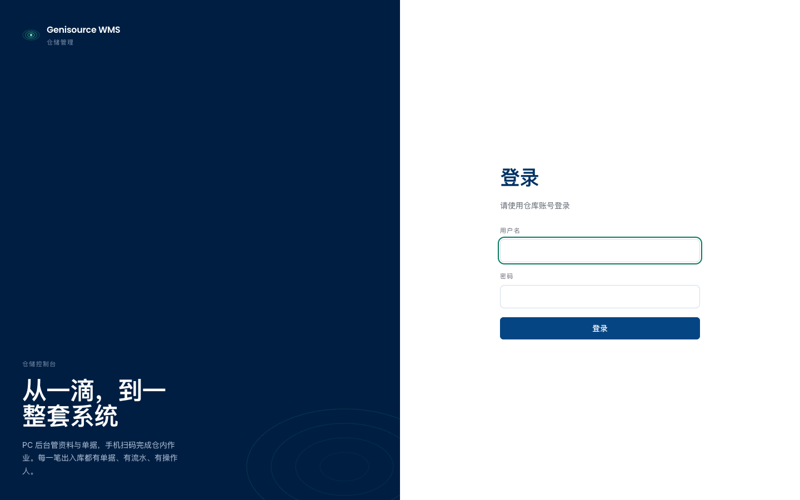 | 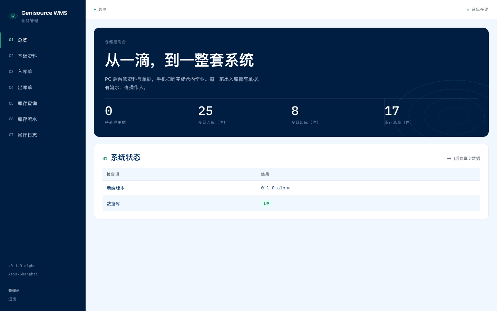 | 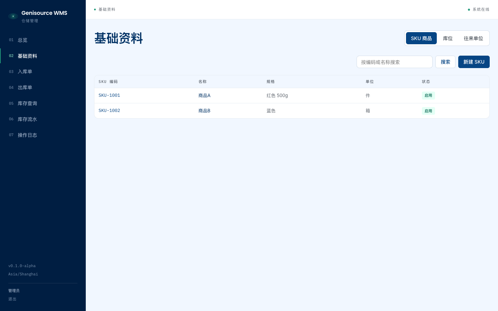 | 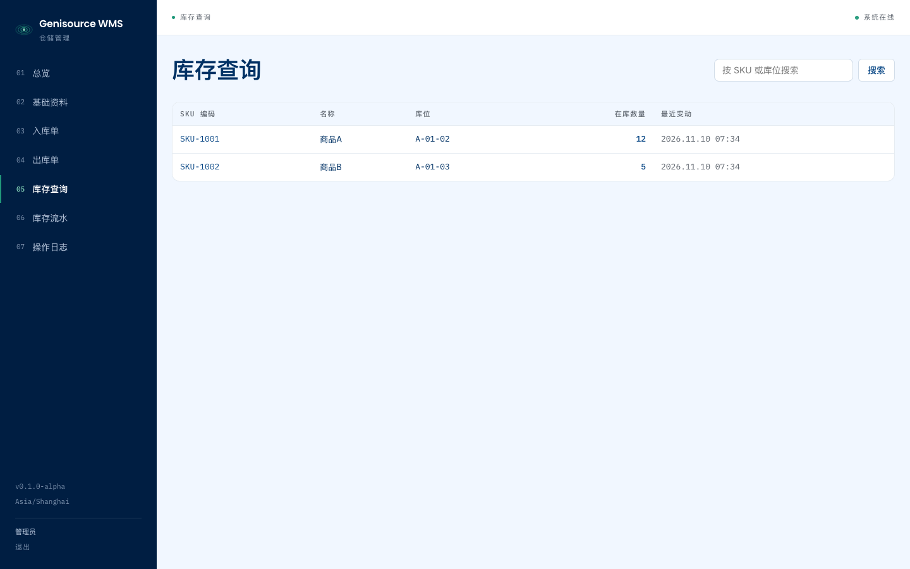 |

| 库存流水 | 操作日志 | 入库单详情 | 出库单列表 |
| --- | --- | --- | --- |
| 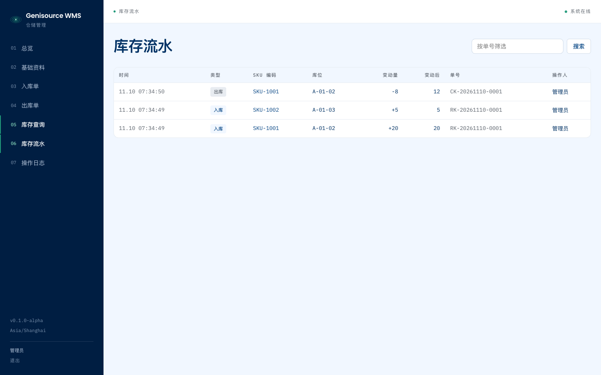 | 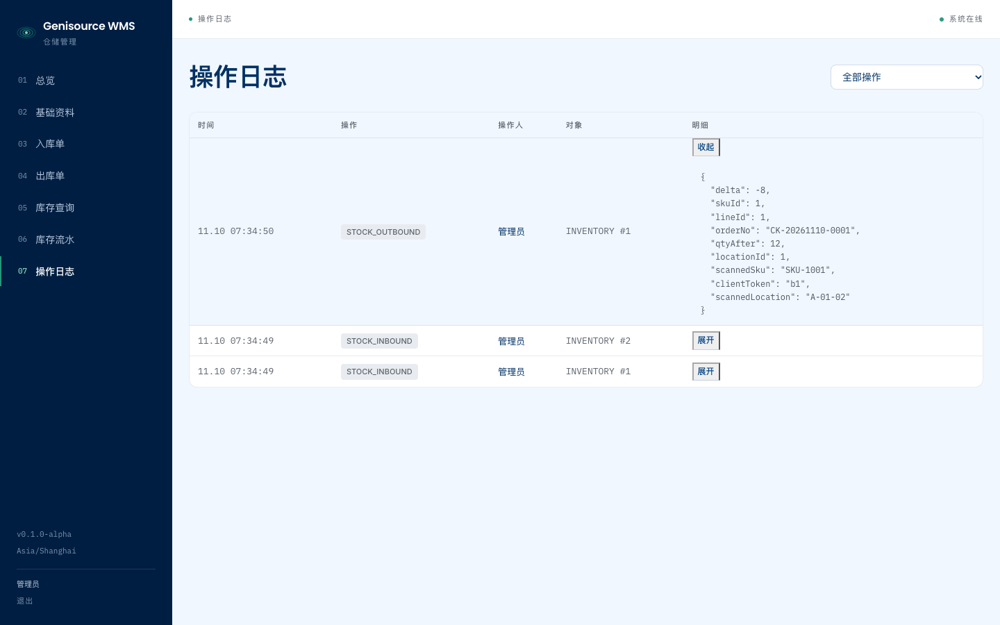 | 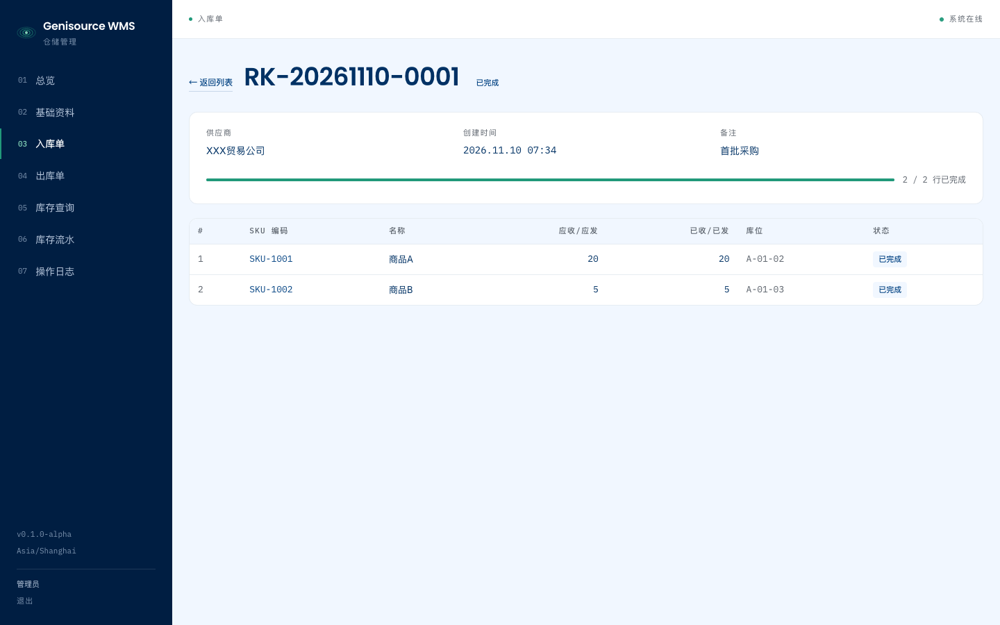 | 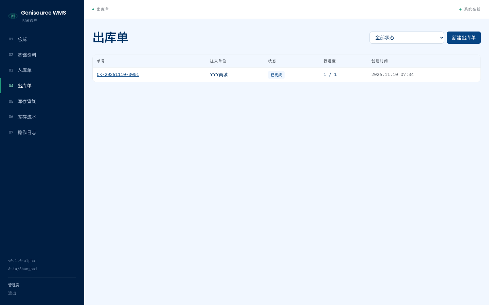 |

**手机端作业（工位终端范式，390×844）**

| 作业任务列表 | 扫码作业中 | 错扫就近提示 | 本单完成 |
| --- | --- | --- | --- |
| 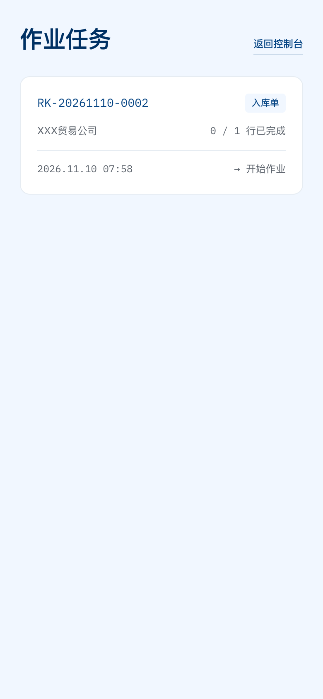 | 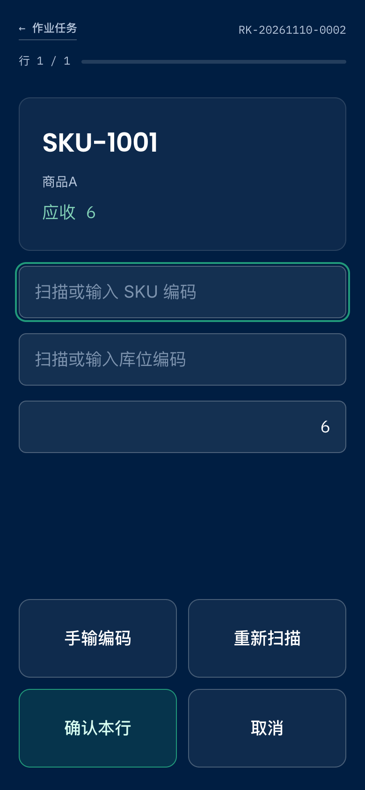 | 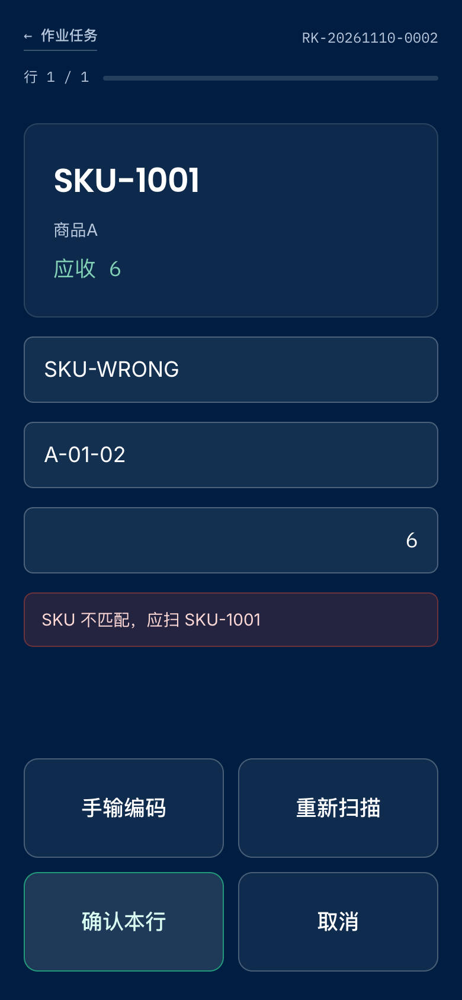 | 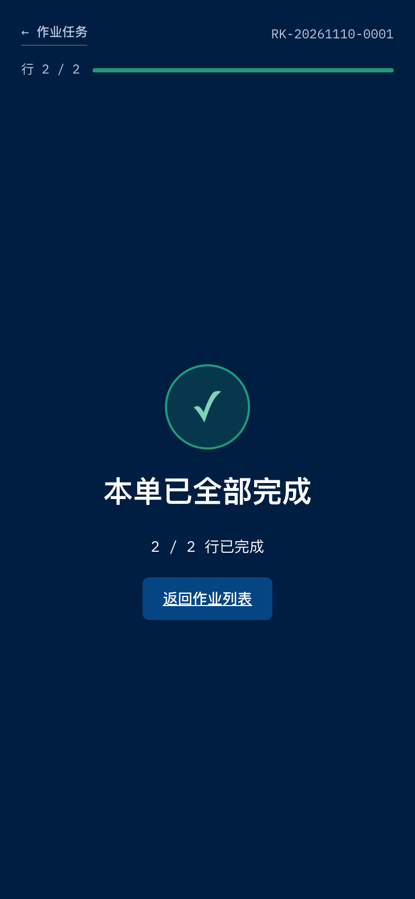 |

采集方式见仓库根 `scripts/`；重新截图需先启动前后端与数据库（端口见 AGENTS.md）。
